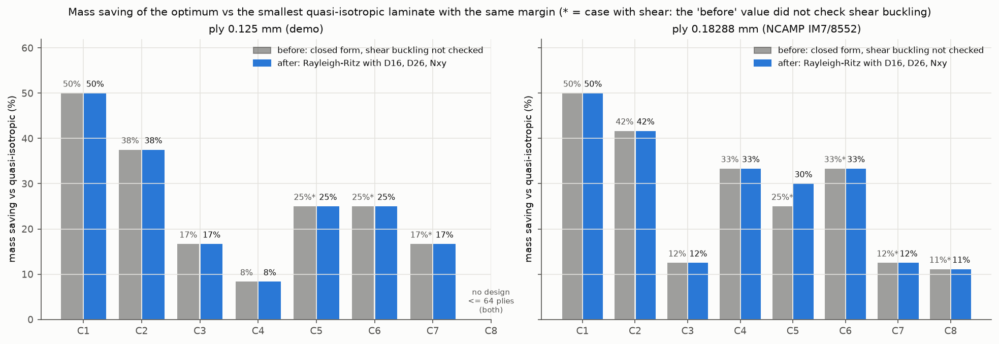

# BÁO CÁO LỚP 1 — TỐI ƯU HÓA THỨ TỰ XẾP LỚP VẬT LIỆU COMPOSITE

*Module `python/optimization` của dự án CompositeAgent — Lớp 1 (nền tảng, không dùng LLM). Ngày 28/10/2026; cập nhật chiều 28/10/2026: mất ổn định do cắt (Rayleigh-Ritz có D16, D26) đưa vào tối ưu.*

> **Đọc nhanh:** xem mục 0 (tóm tắt) và mục 9 (trang tóm tắt tiếng Anh cho GS. Nishikawa).
> Các bảng kết quả được chép nguyên văn từ `results/tables.md` (do `make_tables.py` sinh tự động từ các tệp CSV/JSON
> trong `deliverables/optimization/results/`); các con số trong lời bình được chép từ chính các bảng/tệp đó.

## 0. Tóm tắt kết quả

**Thay đổi chính của bản này (28/10/2026 chiều): mất ổn định do cắt đã nằm trong tối ưu.** Mất ổn định được tính bằng
**Rayleigh-Ritz chuỗi sin kép có D16, D26 và Nxy** (mục 3.3), xét **khi có nén hoặc cắt**, ràng buộc hệ số tải tới hạn
≥ 1,5; mô hình được kiểm chứng trước khi dùng (mục 4.0). Bài Le Riche & Haftka vẫn dùng đúng giả định gốc của họ
(công thức đóng, bỏ qua D16, D26). Kết quả của bản trước được giữ nguyên trong `results/before_ritz/` và mục 4.5.

| Kiểm chứng | Kết quả |
|---|---|
| Mô hình mất ổn định mới (mục 4.0) | Nén thuần trực hướng: trùng công thức đóng cũ (sai lệch ≤ 6.2·10⁻¹⁶, yêu cầu < 0.5 %); tấm vuông đẳng hướng chịu cắt: **k_s = 9.328** (8×8 số hạng) so với 9.34 → **0.13 %** (yêu cầu ≤ 1 %); tấm rất dài: **5.389 (a/b = 10), 5.351 (a/b = 20)** so với 5.35 → 0.73 %, 0.02 % (yêu cầu ≤ 2 %); tấm composite có D16, D26: chuỗi sin so với lời giải đa thức Legendre độc lập chênh ≤ 0.62 %; so với Nemeth (1992, NASA TP-3195): chênh lệch do D16, D26 −50 %/+44 %, ±7.8 %, ±3.9 % so với “khoảng 48 %, 7 %, 3.5 %” trong nguồn, cùng chiều |
| Hội tụ số hạng Ritz (mục 4.2, bảng T4) | Mọi ca dùng 8×8 số hạng (tăng lên 10×10 làm λ của 9 tấm tham chiếu đổi ≤ 0.49 %); các phương án tối ưu cuối: thay đổi ở bước cuối ≤ 0.36 % |
| Python CLT ↔ MATLAB `clt_engine.m`, 60 tấm ngẫu nhiên (52 không đối xứng, 22 có mô-men, 11 vật liệu) | **60/60 đạt**; sai số tương đối lớn nhất ABD 2.1·10⁻¹⁵, ứng suất 2.5·10⁻¹⁵, chỉ số Max Stress 2.5·10⁻¹⁵ (yêu cầu ≤ 10⁻⁹) (không đổi so với bản trước) |
| Tìm kiếm chính xác (nhánh-cận, cận chứng minh được, mục 3.5) | **15/16 bài chứng minh được tối ưu toàn cục** (14 tối ưu, 1 không khả thi), mỗi bài ≤ 10 s; bài cắt thuần lớp 0.125 mm: chứng minh **n* = 42 lớp** (cận dưới 42 = số lớp GA tìm được) nhưng **biên tối ưu chưa chứng minh** (quá nhiều cách xếp để liệt kê) |
| GA, GA + tìm kiếm cục bộ, NSGA-II ↔ tối ưu chính xác: 15 bài đã chứng minh, 20 seed, ngân sách 10 000 | **GA + tìm kiếm cục bộ 300/300**; GA 294/300 (C4 lớp 0.125 mm 19/20, C5 lớp 0.18288 mm 15/20); **NSGA-II 213/300** (kém ở các ca mất ổn định có D16, D26: 0–18/20; vẫn dừng đúng số lớp tối ưu ở 298/300 lần, biên thấp hơn tối ưu ≤ 2.5 %) |
| Le Riche & Haftka (1993; thông số từ luận án Le Riche 1994), chế độ số lớp cố định | Chạy lại với mã mới: **vẫn trùng giá trị tối ưu công bố** 3973.01, 9998.19, 13518.66; ca Ny/Nx = 0.25 tìm được 12678.78 (+0.031 % so với thiết kế GA in trong luận án) (mục 4.6) |
| Le Riche & Haftka (1995), bài ít lớp nhất | n* = 48 lớp ở cả 3 ca như nguồn; thiết kế tối ưu ca 2 và ca 3 trùng nguyên văn Bảng 2 của nguồn (mục 4.6) |
| pytest (CLT, tiêu chuẩn, mất ổn định cũ và mới, luật, repair, thuật toán, vật liệu, MATLAB) | **102/102 đạt** (78 cũ + 13 cho mất ổn định có D16, D26 + 11 cho tùy chọn hai chiều lực cắt, gồm 3 test MATLAB; 30/10) |
| Kiểm tra lại các phương án tối ưu cuối bằng MATLAB | **51/51 đạt** (mục 4.7): sai số tương đối lớn nhất ABD 1.7·10⁻¹⁵, ứng suất 3.1·10⁻¹⁵ |

**Giảm khối lượng so với tấm tựa đẳng hướng `[0/45/−45/90]ns` nhỏ nhất đạt cùng biên an toàn — nay cho MỌI ca, kể cả
ca có lực cắt** (mục 4.4, cùng mô hình mất ổn định cho cả hai tấm):
* lớp 0.125 mm: kéo một phương **−50 %** (24 so với 48 lớp), kéo hai phương −37.5 % (20/32), nén một phương −16.7 %
  (20/24), nén hai phương −8.3 % (22/24), **cắt thuần −25 % (42/56)**, kéo + cắt −25 % (24/32), nén + cắt −16.7 %
  (20/24); tải rất lớn: **không khả thi trong 64 lớp** (biên tốt nhất 1.043 < 1.5; tựa đẳng hướng cần 104 lớp).
* lớp 0.18288 mm (NCAMP): −50 % (16/32), −41.7 % (14/24), −12.5 % (14/16), −33.3 % (16/24), **cắt thuần −30 %
  (28/40)**, −33.3 % (16/24), −12.5 % (14/16), tải rất lớn −11.1 % (64/72).

**So với bản trước** (mục 4.5): thay đổi lớn ở **cắt thuần**: 12 → **42 lớp** (0.125 mm) và 12 → **28 lớp**
(0.18288 mm) — phương án 12 lớp cũ (lớp 0.125 mm) chỉ chịu 2.6 % tải trước khi mất ổn định; các ca khác giữ nguyên số lớp, biên ca
nén + cắt giảm nhẹ (1.762 → 1.751; 1.835 → 1.824).

**Cảnh báo quan trọng nhất** (mục 4.5): với D16, D26 ≠ 0, tối ưu **tận dụng chiều của lực cắt đề cho** (phương án cắt
thuần có |D16|/D11 ≈ 0.4). Nếu lực cắt **đổi chiều**, biên của phương án cắt thuần chỉ còn **0.556** (0.125 mm) /
**0.514** (0.18288 mm), của ca nén + cắt còn 1.49 / 1.56. Khi tải cắt có thể đổi chiều phải tối ưu đồng thời cho
+Nxy và −Nxy (chưa làm: Lớp 1 tối ưu một trường hợp tải).


---

## 1. Bài toán

### 1.1 Composite nhiều lớp là gì, vì sao thứ tự xếp lớp quan trọng
Một **tấm composite nhiều lớp (laminate)** được ghép từ nhiều **lớp (ply)** mỏng; mỗi lớp là sợi carbon song song
trong nhựa epoxy, rất cứng và bền theo phương sợi (phương 1), yếu theo phương ngang (phương 2). Người thiết kế chọn
**góc sợi** của từng lớp (ở đây chỉ 0°, +45°, −45°, 90° như thông lệ ngành hàng không) và **thứ tự xếp lớp**
(stacking sequence), ví dụ `[0/45/−45/90]s` (chữ `s` = đối xứng qua mặt giữa: nửa còn lại là ảnh gương).

* **Số lớp** quyết định khối lượng (cùng vật liệu, cùng độ dày lớp → khối lượng tỉ lệ số lớp).
* **Số lượng lớp mỗi góc** quyết định độ cứng màng **A** (kéo – nén – cắt trong mặt phẳng) → quyết định độ bền.
* **Thứ tự** quyết định độ cứng uốn **D** (lớp càng xa mặt giữa càng góp nhiều) → quyết định **mất ổn định
  (buckling)** khi tấm chịu nén hoặc cắt.

### 1.2 Mục tiêu của Lớp 1
Tìm thứ tự xếp lớp **có ít lớp nhất** (nhẹ nhất) sao cho **biên an toàn ≥ hệ số an toàn** (mặc định 1.5) và
thỏa mọi **luật thiết kế**; nếu nhiều phương án cùng số lớp thì chọn phương án có biên an toàn lớn nhất. Ngoài ra
xây dựng **đường Pareto** (đánh đổi giữa số lớp và biên an toàn) và tái tạo bài kiểm tra kinh điển của
Le Riche & Haftka.

---

## 2. Giả định và quy ước

| Hạng mục | Lựa chọn trong Lớp 1 |
|---|---|
| Tải | Lực màng trong mặt phẳng Nx, Ny, Nxy (N/m); **kéo dương, nén âm**. **Không xét mô-men** (Mx = My = Mxy = 0; hàm `optimize` từ chối nếu có mô-men). |
| Nhiệt, ẩm | Bỏ qua ứng suất nhiệt và độ ẩm. |
| Tiêu chí phá hủy | **Lớp gãy đầu tiên** (first-ply failure): tấm coi như hỏng khi lớp đầu tiên đạt tiêu chuẩn bền. |
| Đơn vị | SI trong mọi tính toán (Pa, m, N/m). Riêng bài Le Riche & Haftka đổi từ psi, in, lb/in bằng hệ số chính xác. |
| Độ dày lớp | Tham số; mặc định **0.125 mm** (nhất quán với demo). Bộ thứ hai: **0.18288 mm = 0.0072 in**, độ dày lớp danh định của Hexcel 8552/IM7 (190 g/m²) theo NCAMP NCP-RP-2009-028 Rev B — giá trị lấy từ cột `Vf_note` của dòng IM7/8552 trong `composite_lamina_dataset_v4.csv` (“FAW 190 gsm / (rho_f 1.78 g/cc x tply 0.0072 in)”). |
| Tấm | Chữ nhật a × b, **tựa đơn bốn cạnh**; mặc định a = b = 0.5 m. |
| Vật liệu | Mặc định **IM7/8552**, số đo thật NCAMP (E1 = 162.1 GPa, E2 = 8.96 GPa, G12 = 4.69 GPa, ν12 = 0.316, Xt = 2212, Xc = 1731, Yt = 64.1, Yc = 286, S = 91.1 MPa), lấy qua cơ chế sẵn có `materials.py`. |
| Thước đo chung | **Hệ số dự trữ RF** (reserve factor) = số lần có thể nhân **toàn bộ** tải lên trước khi đạt tới hạn. **Biên an toàn** của phương án = min RF qua mọi lớp và mọi tiêu chuẩn. Ràng buộc: biên an toàn ≥ hệ số an toàn (mặc định 1.5, đổi được). |
| Tsai-Wu | F12 = F12\*·√(F11·F22) với **F12\* = −0.5** (giá trị khuyến nghị thường được trích từ Tsai & Hahn 1980); tham số đổi được. |
| Mất ổn định | **Rayleigh-Ritz chuỗi sin kép có D16, D26 và Nxy** (mục 3.3), xét **khi có nén (Nx < 0 hoặc Ny < 0) hoặc cắt (Nxy ≠ 0)**; hệ số tải tới hạn = trị riêng dương nhỏ nhất; không có trị riêng dương → RF = ∞; dùng đúng dấu của Nxy đề cho. Bài Le Riche & Haftka giữ công thức đóng của nguồn (nén hai phương, bỏ qua D16, D26). |
| Góc lớp | {0, +45, −45, 90}. Hai cách mã hóa: theo **từng lớp** (mặc định, mịn nhất: số lớp bước 2) và theo **cặp lớp** 0₂ / ±45 / 90₂ như Le Riche & Haftka (số lớp bước 4). |
| Luật thiết kế (bật/tắt từng luật) | **Đối xứng**; **cân bằng** (#+45 = #−45); **mỗi họ hướng 0, ±45, 90 ≥ 10 % số lớp** (±45 tính chung một họ); **không quá 4 lớp cùng góc liền nhau**, tính trên cả tấm (kể cả hai lớp kề mặt giữa khi đối xứng). Số lớp 8–64. |

---

## 3. Phương pháp

### 3.1 Bộ tính CLT bằng Python (`clt.py`, `evaluate.py`)
**Lý thuyết tấm nhiều lớp cổ điển (CLT)**: từ E1, E2, G12, ν12 tính ma trận độ cứng lớp **Q**, xoay theo góc lớp
thành **Q̄**, cộng theo chiều dày được ma trận **ABD** (A: màng, B: ghép màng–uốn, D: uốn). Giải
[N; M] = ABD·[ε⁰; κ] được biến dạng mặt giữa ε⁰ và độ cong κ, rồi biến dạng/ứng suất từng lớp theo trục vật liệu.
**Cùng quy ước với `matlab/clt_engine.m`**: lớp 1 ở đáy (z = −h/2), cùng công thức Q̄ (m⁴, m²n²…), biến dạng kỹ
thuật, ứng suất lấy ở **giữa chiều dày lớp**, cùng chỉ số Max Stress. Hàm `cosd/sind` tái tạo cách rút gọn góc của
MATLAB nên 90° cho đúng 0.

**Vector hóa**: với tấm đối xứng chỉ chịu lực màng, B = 0 và biến dạng đều theo chiều dày (ε⁰ = A⁻¹N); A chỉ phụ
thuộc **số lớp mỗi góc**, nên ứng suất mỗi lớp chỉ phụ thuộc góc của nó; D = Σ Q̄(góc)·trọng số vị trí. Nhờ vậy
đánh giá được hàng triệu phương án/giây theo lô. Đường tính tổng quát (A, B, D, độ cong) dùng cho tấm không đối xứng
và để đối chiếu với MATLAB; hai đường khớp nhau tới 3·10⁻¹⁵ (test `test_fast_symmetric_path_equals_general_path`).

### 3.2 Tiêu chuẩn bền và hệ số dự trữ (`failure.py`)
* **Max Stress**: chỉ số FI = max(σ1/Xt hoặc −σ1/Xc, σ2/Yt hoặc −σ2/Yc, |τ12|/S) — đúng như MATLAB.
  Ứng suất tỉ lệ tuyến tính với tải nên **RF = 1/FI**.
* **Tsai-Wu**: F1σ1 + F2σ2 + F11σ1² + F22σ2² + F66τ12² + 2F12σ1σ2 = 1. Nhân tải với RF thì ứng suất nhân RF:
  a·RF² + b·RF − 1 = 0 (a: phần bậc hai, b: phần bậc nhất). Với |F12\*| < 1 phần bậc hai xác định dương nên có
  đúng một nghiệm dương; dùng công thức nghiệm ổn định số (không trừ hai số gần bằng nhau).
* **Max Strain** (chỉ cho bài Le Riche & Haftka): RF = min(ε1u/|ε1|, ε2u/|ε2|, γ12u/|γ12|).
* **Thiếu giới hạn bền**: nếu vật liệu thiếu giá trị nào (ô trống trong CSV, hoặc người dùng không cho), giá trị đó
  được thay bằng **dự đoán ML theo nhóm** của cơ chế sẵn có và **in cảnh báo** ghi rõ tên đại lượng
  (`material.py`, test `test_missing_strength_filled_by_ml_with_warning`).

### 3.3 Mất ổn định (`buckling.py`)
**Công thức đóng** (tấm trực hướng đặc biệt tựa đơn, nén hai phương; Whitney 1987; đúng phương trình (3.1) của
Le Riche 1994):

λ(m, n) = π²·[D11(m/a)⁴ + 2(D12 + 2D66)(m/a)²(n/b)² + D22(n/b)⁴] / [(m/a)²·(−Nx) + (n/b)²·(−Ny)],

chỉ các mode có mẫu dương mới mất ổn định được; **λ_cr = min theo (m, n)** = hệ số tải tới hạn = RF_buckling.
**Dò mode có chứng minh đủ**: đặt μ = (m/a)², ν = (n/b)²; vì D12 + 2D66 ≥ 0 nên tử ≥ min(D11, D22)·(μ+ν)²/2 và mẫu
≤ Nmax·(μ+ν), do đó λ(m,n) ≥ π²·min(D11,D22)·(μ+ν)/(2Nmax). Sau khi có ước lượng λ0 từ các mode nhỏ, mọi mode có
μ+ν > 2·Nmax·λ0/(π²·Dmin) chắc chắn kém hơn λ0, nên chỉ cần dò m ≤ a√R, n ≤ b√R. Test so với dò thô 60×60 mode trên
200 trường hợp ngẫu nhiên (kể cả kéo ngang): khớp tới 10⁻¹².

Công thức đóng này **chỉ còn dùng cho bài Le Riche & Haftka** (giữ đúng giả định gốc của họ: nén hai phương, bỏ
qua D16, D26; mục 4.6) và làm mốc kiểm chứng. **Các bài của dự án dùng mô hình Rayleigh-Ritz dưới đây.**

**Mô hình chính — Rayleigh-Ritz có D16, D26 và Nxy** (`buckling.RitzModel`, từ bản này):

* *Ý tưởng (cho người mới):* khi tải nén hoặc cắt đủ lớn, tấm mỏng đột ngột võng ra khỏi mặt phẳng. Phương pháp
  **Rayleigh-Ritz** đoán **hình dạng võng** là tổng của các hình dạng biết trước nhân với biên độ chưa biết,
  ở đây chuỗi sin kép w = Σₘ Σₙ A_mn·sin(mπx/a)·sin(nπy/b), m ≤ M, n ≤ N (mỗi hàm sin bằng 0 ở bốn cạnh, đúng điều
  kiện tựa đơn về độ võng). Tấm mất ổn định khi năng lượng biến dạng uốn U không còn “thắng” được công của lực
  trong mặt phẳng V.
* *Năng lượng* (Whitney 1987): U = ½∫[D11 w,xx² + 2D12 w,xx w,yy + D22 w,yy² + 4D66 w,xy² **+ 4D16 w,xx w,xy +
  4D26 w,yy w,xy**] dA; V = ½∫[Nx w,x² + Ny w,y² + 2Nxy w,x w,y] dA. Với U = ½AᵀKA, V = ½AᵀGA, tấm mất ổn định khi
  tải nhân λ lần thỏa det(K + λG) = 0, tức **bài toán trị riêng tổng quát K·A = λ·(−G)·A**. *Trị riêng* λ là số mà
  với nó phương trình có nghiệm A ≠ 0 (nghiệm A chính là hình dạng võng). Các tích phân có dạng đóng (tích phân
  sin–cos), **tính sẵn một lần** cho mỗi (a, b, M, N, tải); D16, D26 và Nxy ghép các mode (m, n), (p, q) có m+p lẻ
  và n+q lẻ nên bài toán vẫn tách thành hai khối độc lập (m+n chẵn / lẻ).
* *Hệ số tải tới hạn* = **trị riêng dương nhỏ nhất** (= 1/μ_max với μ_max là trị riêng dương lớn nhất của
  (−G)A = μKA, giải theo lô bằng phân tích Cholesky của K). **Thành phần kéo** nằm sẵn trong G với dấu làm tăng ổn
  định; **nếu không có trị riêng dương thì tải đó không thể làm tấm mất ổn định: RF_buckling = ∞** (ghi “inf”).
  Kiểm tra mất ổn định được áp dụng **khi có nén (Nx < 0 hoặc Ny < 0) hoặc có cắt (Nxy ≠ 0)**.
* *Dấu của lực cắt:* khi D16, D26 ≠ 0, cắt dương và cắt âm cho kết quả khác nhau (ví dụ [(45/−45)₄/0/90]s chịu
  Nx = −10 kN/m: λ = 1.626 với Nxy = +5 kN/m, 1.729 với Nxy = −5 kN/m); chương trình dùng **đúng dấu của tải đề
  cho** (Nxy > 0 theo quy ước CLT của `clt_engine.m`). Khi D16 = D26 = 0, hai dấu cho cùng kết quả (test).
* ⚠ ***Cận trên, hội tụ chậm:*** nghiệm Ritz luôn là **cận trên** của tải tới hạn thật (hình dạng đoán càng thiếu
  linh hoạt thì tải tính ra càng cao; thêm số hạng thì giá trị giảm dần về giá trị thật). Khi D16, D26 ≠ 0, chuỗi
  sin kép **không thỏa chính xác điều kiện biên mô-men bằng 0** ở cạnh tựa đơn: M_xx = −(D11 w,xx + D12 w,yy +
  2D16 w,xy), mọi hàm sin có w,xx = w,yy = 0 ở cạnh nhưng w,xy ≠ 0, nên M_xx ≠ 0. Phương pháp vẫn hội tụ (điều kiện
  mô-men là điều kiện tự nhiên, không bắt buộc với Ritz) nhưng **chậm hơn**, và kết quả là cận trên. Để kiểm tra,
  một lời giải Ritz **độc lập** dùng đa thức Legendre nhân (1 − ξ²) (không ép mô-men bằng 0) và tích phân số Gauss
  (`ritz_polynomial`) được so sánh (mục 4.0).
* *Hội tụ:* số số hạng của từng ca được chọn bằng nghiên cứu hội tụ (`run_cases.choose_terms`): k nhỏ nhất ≥ 8 sao
  cho tăng từ k lên k + 2 làm λ của 9 tấm tham chiếu (tựa đẳng hướng và ±45 ở ngoài cùng, D16/D26 lớn nhất) thay đổi
  < 0.5 %. Mọi phương án tối ưu cuối được tính lại với chuỗi tăng dần từ 6×6 (bước 2) đến khi thay đổi < 0.5 %
  (`buckling.converge`); **biên an toàn báo cáo dùng giá trị nhỏ hơn** trong hai giá trị (số hạng tối ưu, chuỗi hội
  tụ). Bằng chứng hội tụ cho từng ca: bảng T4 (mục 4.2).
* *Tốc độ:* tích phân cơ sở tính sẵn; trị riêng tính theo lô; **cache theo ma trận D** (cùng D không tính lại);
  trong GA đơn mục tiêu và vét cạn, **mất ổn định chỉ được tính cho phương án đã đạt độ bền** (RF độ bền ≥ 1,5) —
  phương án trượt độ bền đằng nào cũng không khả thi; NSGA-II tính đủ cho mọi phương án vì cần biên chính xác trên
  đường Pareto. Với 8×8 số hạng một phương án mất ≈ 0,25 ms (một luồng).
* Bản trước (Ritz bỏ qua D16, D26, chỉ là phần bổ sung) được giữ trong `buckling.ritz` để so sánh; khi D16 = D26 = 0
  mô hình mới trùng nó tới 10⁻¹⁰ (test).

### 3.4 Biến thiết kế, luật thiết kế và cơ chế sửa (`rules.py`)
Một phương án là một **chuỗi ký hiệu** = nửa tấm từ mặt ngoài vào mặt giữa (khi đối xứng). Ký hiệu “rỗng” cho phép
số lớp thay đổi; chuỗi được **chuẩn hóa** (dồn về phía mặt giữa) nên mỗi tấm có đúng một chuỗi. `check_rules()` là
phép kiểm tra gốc trên tấm đầy đủ. **Cơ chế sửa (repair)** biến chuỗi bất kỳ thành chuỗi hợp lệ: chỉnh số lớp →
cân bằng ±45 → tối thiểu 10 % mỗi họ (lấy từ họ dư nhiều nhất) → bảo đảm số lượng xếp được trong giới hạn 4 lớp liền
→ đổi chỗ các lớp vi phạm; nếu không được thì dựng lại tham lam từ mặt giữa ra. Kiểm thử ngẫu nhiên: 1 500 chuỗi ×
19 tổ hợp luật/mã hóa (thêm 3 000 chuỗi × 17 tổ hợp khi phát triển), **không lần nào** trả về phương án vi phạm.

### 3.5 Vét cạn và cận chứng minh được (`exhaustive.py`)
**Với mô hình mất ổn định mới (có D16, D26)** cách “vét cạn theo họ góc” dưới đây **không còn đúng**: D16 = D26 =
(Q11 − Q22)/4 × Σ(±1 × trọng số vị trí) phụ thuộc **thứ tự và dấu** của từng lớp ±45, nên phải xét từng chuỗi góc
có dấu. Tìm kiếm chính xác mới (`exact_full`) làm theo từng số lớp n, **nhánh-cận** (branch and bound: loại bỏ cả
nhóm phương án khi chứng minh được nhóm đó không thể tốt hơn phương án tốt nhất đã có) ở hai mức, với các **cận được
chứng minh**:
* *Cận Rayleigh:* với mọi vector mode A cố định (Aᵀ(−G)A > 0), λ(D) ≤ R(A; D) = AᵀK(D)A / Aᵀ(−G)A, vì λ là giá trị
  nhỏ nhất của R theo mọi A; R **tuyến tính** theo D = Σ wₖ Q̄(θₖ).
* *Mức bộ số lượng lớp:* với số lớp mỗi góc cố định, giá trị lớn nhất của Σ wₖ g(θₖ) (g = Σ_c r_c Q̄_c) theo mọi cách
  xếp đạt được khi đặt góc có g lớn nhất ra ngoài cùng (bất đẳng thức sắp xếp lại; bỏ qua luật liền nhau nên cận chỉ
  cao hơn). Lấy min theo vài mode A (và tổ hợp lồi của từng cặp) → **cận trên của λ cho mọi cách xếp** của bộ số
  lượng đó; cùng với RF độ bền chính xác: UB = min(RF độ bền, cận λ). Bộ số lượng có UB nhỏ hơn biên tốt nhất đã có
  bị loại; nếu mọi bộ của một số lớp có UB < 1,5 thì số lớp đó **chắc chắn không khả thi** (cận dưới chứng minh được).
* *Mức phương án:* trong một bộ số lượng, mọi cách xếp hợp lệ được sinh ra; cận min_j R(A_j; D) chỉ tốn một tích vô
  hướng; bài toán trị riêng chỉ được giải cho phương án có cận vượt biên tốt nhất đã có; dừng sớm khi biên đạt RF độ
  bền của bộ đó (không thể vượt). Một số lớp được coi là **xong** khi không còn cận nào vượt biên tốt nhất.
* Cận là cận của **cùng mô hình Ritz với cùng số số hạng** như khi tối ưu, nên “tối ưu chính xác” nghĩa là tối ưu
  toàn cục của mô hình mà GA/NSGA-II tối ưu. Kiểm tra: trên các bài nhỏ (8–16 lớp, 3 tổ hợp tải) kết quả trùng
  liệt kê thô mọi phương án hợp lệ tới 10⁻⁹ (test `test_exact_full_equals_brute_force`). Bộ số lượng có hơn 3 triệu
  cách xếp không được liệt kê → số lớp đó chưa xong (trừ khi cận chứng minh được không khả thi) → trạng thái
  “unknown (time limit)”, kèm cận dưới chứng minh được và phương án tốt nhất đã biết. **Phạm vi vét cạn bị thu hẹp
  so với bản trước** ở bài cắt thuần lớp 0.125 mm (mục 4.2).

Các mục dưới đây là của bản trước (mô hình công thức đóng), vẫn dùng cho bài chỉ có độ bền và cho Le Riche & Haftka:
* **Vét cạn theo “họ góc”**: với luật đối xứng + cân bằng, biên an toàn chỉ phụ thuộc số lớp mỗi góc (độ bền) và
  D11, D12, D22, D66 (mất ổn định) — các đại lượng này **như nhau cho +45 và −45**. Vì vậy chỉ cần liệt kê chuỗi họ
  {0, ±45, 90} (3^L thay vì 4^L); mỗi chuỗi có số lớp ±45 chẵn được đổi thành lớp thật bằng cách xen kẽ +45/−45 —
  luôn cân bằng và không tạo dãy cùng góc. Test so với liệt kê đầy đủ 4^L (bộ kiểm tra luật gốc) trên 3 tải: trùng
  tới 10⁻¹². Tốc độ ≈ 0.3–0.8 triệu chuỗi/giây (công thức đóng); giới hạn 10 phút/bài (tự ước lượng và dừng, ghi “unknown”).
* **Vét cạn theo số lượng** (khi không có mất ổn định): biên an toàn chỉ phụ thuộc bộ số lượng (n0, n+45, n−45,
  n90). Liệt kê mọi bộ số lượng + **quy hoạch động chính xác** kiểm tra có xếp được trong giới hạn 4 lớp liền →
  **tối ưu chính xác cho mọi số lớp tới 64** trong < 1 s.
* **Cận dưới chứng minh được của số lớp**: với mỗi bộ số lượng, độ bền tính chính xác, còn mất ổn định bị chặn trên
  bằng D “lạc quan” (mỗi thành phần D11, D22, D12+2D66 được cực đại riêng bằng cách đặt lớp có giá trị lớn nhất ra
  ngoài — bất đẳng thức sắp xếp lại); λ tăng theo các thành phần này nên λ(D) ≤ λ(D lạc quan). Nếu mọi bộ số lượng
  của một số lớp có cận < hệ số an toàn thì số lớp đó **chắc chắn không khả thi**. Cận này được nâng thêm qua các
  số lớp mà vét cạn đã chứng minh không khả thi (“cận dưới hiệu lực”).

### 3.6 Thuật toán di truyền và NSGA-II (`ga.py`, `nsga2.py`)
* **GA đơn mục tiêu**: quần thể 30, chọn lọc giải đấu nhị phân theo **thứ tự từ điển** (khả thi trước; khả thi thì
  ít lớp hơn rồi biên lớn hơn; không khả thi thì vi phạm nhỏ hơn — quy tắc Deb 2000), giữ 2 phương án tốt nhất
  (elitism), lai ghép hai điểm (xác suất 1) trên chuỗi canh theo mặt giữa, đột biến từng lớp (1/L), thêm/bớt lớp
  (0.10/0.10), **hoán vị hai lớp** (0.7, toán tử “stack swap” của Le Riche & Haftka), sửa sau mỗi phép biến đổi.
* **GA + tìm kiếm cục bộ (memetic)**: mỗi khi phương án tốt nhất được cải thiện, leo đồi dốc nhất trên mọi hoán vị
  hai lớp khác góc, mọi đổi góc một lớp và (bài ít lớp nhất) mọi bỏ một lớp; tại cực trị cục bộ khả thi còn thử
  **bớt lớp**: bỏ từng lớp, chọn 3 phương án mỏng hơn có biên lớn nhất, leo đồi tối đa biên ở số lớp mới, nhận nếu đạt
  lại hệ số an toàn. Mọi đánh giá tính trong cùng ngân sách. **Biến thể này được thêm sau khi GA cơ bản trượt tối ưu
  ở các bài “đánh lừa GA” của Le Riche & Haftka 1995** (mục 4.6; bước bớt lớp thêm sau khi bản đầu vẫn trượt ca 2);
  cả hai biến thể được báo cáo trên mọi bài, kết quả trong báo cáo là của phiên bản cuối.
* **NSGA-II** (pymoo 0.6.2, Deb et al. 2002): hai mục tiêu (số lớp ↓, −biên an toàn ↓); dùng **cùng** khởi tạo, lai
  ghép, đột biến và **repair** như GA (mọi phương án luôn thỏa luật), loại trùng lặp trên chuỗi chuẩn hóa; quần thể
  40. Đáp án “ít lớp nhất” lấy từ quần thể cuối: phương án khả thi ít lớp nhất, hòa thì biên lớn nhất.
* **Ngân sách** = số **phương án khác nhau** được phân tích (phương án lặp lại lấy từ bộ nhớ đệm), 10 000 cho mỗi
  lần chạy; dừng sớm nếu 100 thế hệ liền không có phương án mới. **20 seed cố định** (0–19) cho mỗi bài × mỗi thuật
  toán (bản này: 16 bài × 3 thuật toán × 20 seed = 960 lần chạy, tối đa 4 tiến trình song song). **Thành công** = phương án cuối có **đúng số lớp tối ưu và biên an toàn bằng
  tối ưu toàn cục** (sai số tương đối 10⁻⁹) trong ngân sách; ghi số lần đánh giá lúc lần đầu đạt và thời gian chạy.
* Tham số GA/NSGA-II chọn trước, **không** tinh chỉnh trên 8 ca tải kiểm tra.

### 3.7 Kiểm chứng
0. **Mô hình mất ổn định mới, TRƯỚC khi dùng** (`verify_buckling.py`, `tests/test_buckling_full.py`): nén thuần tấm
   trực hướng so với công thức đóng (< 0.5 %), k_s tấm vuông (≤ 1 % so với 9.34), tấm rất dài (≤ 2 % so với 5.35),
   lời giải Ritz đa thức độc lập, kết quả công bố cho tấm composite (Nemeth 1992). Không đạt thì không dùng.
1. **Python ↔ MATLAB** trên ≥ 50 tấm ngẫu nhiên (`verify_matlab.py`): ABD, ứng suất từng lớp, chỉ số Max Stress;
   sai số tương đối ≤ 10⁻⁹ (định nghĩa sai số ở đầu `matlab_check.py`; B chuẩn hóa theo A·h vì B = 0 với tấm đối xứng).
2. **GA, GA+LS, NSGA-II ↔ tìm kiếm chính xác** trên 8 ca tải × 2 độ dày lớp.
3. **Le Riche & Haftka** (chế độ riêng, công thức đóng như nguồn, tối đa tải phá hủy với số lớp cố định).
4. **Mọi phương án tối ưu cuối** được tính lại bằng `clt_engine.m` (`matlab_recheck.py`).
5. **pytest** cho bộ tính CLT, từng tiêu chuẩn, mất ổn định (công thức đóng, Ritz cũ, Ritz có D16/D26, cận, tìm kiếm
   chính xác so với liệt kê thô), từng luật, repair, từng thuật toán, vật liệu, MATLAB.

---

## 4. Kết quả

Tấm IM7/8552 0.5 m × 0.5 m tựa đơn, hệ số an toàn 1.5, luật mặc định (đối xứng, cân bằng, 10 %, ≤ 4 lớp liền),
8–64 lớp, mã hóa từng lớp. Tám ca tải được chọn **trước** khi chạy GA, từ ước lượng thô sao cho mỗi ca đều không tầm
thường (`experiments/cases.py`): kéo/cắt cỡ MN/m (độ bền quyết định), nén cỡ chục kN/m (tấm 0.5 m không gân mất ổn định
ở tải nhỏ hơn rất nhiều so với tải phá hủy bền), và một tải rất lớn.

### 4.0 Kiểm chứng mô hình mất ổn định mới (làm TRƯỚC khi dùng trong tối ưu)
Chạy bằng `-m optimization.experiments.verify_buckling` (kết quả: `results/buckling_verification.json`, `.csv`);
cùng các ca là pytest `tests/test_buckling_full.py`. k_s định nghĩa theo N_cr = k_s·π²·D/b² (D = độ cứng uốn tấm
đẳng hướng, b = cạnh ngắn).

| Kiểm chứng | Số hạng | Kết quả | Giá trị chuẩn (nguồn) | Sai lệch | Yêu cầu |
|---|---|---|---|---|---|
| Nén thuần, tấm trực hướng (D16 = D26 = 0), 200 tấm ngẫu nhiên + 6 tấm [0/90] thật, so với công thức đóng của bản cũ | 12×12 (theo a/b) | trùng | công thức đóng | ≤ 6.2·10⁻¹⁶ (tương đối) | < 0.5 % — **đạt** |
| Tấm vuông đẳng hướng tựa đơn, cắt thuần | 8×8 (6×6 → 8×8 đổi 0.11 %) | k_s = 9.328 | 9.34 (Stein & Neff 1947; Timoshenko & Gere 1961) | 0.125 % | ≤ 1 % — **đạt** |
| Như trên, lời giải đa thức Legendre độc lập (p = 16) | 289 hàm | k_s = 9.3245 | 9.34 | 0.17 % | (đối chiếu) |
| Tấm rất dài a/b = 10, cắt thuần | 60×6 | k_s = 5.389 | 5.35 (Southwell & Skan 1924; Timoshenko & Gere 1961) | 0.73 % | ≤ 2 % — **đạt** |
| Tấm rất dài a/b = 20, cắt thuần | 120×6 | k_s = 5.351 | 5.35 | 0.016 % | ≤ 2 % — **đạt** |
| Tấm a/b = 5 (chưa “rất dài”), cắt thuần | 30×6 | k_s = 5.532 | 5.35 + 4(b/a)² = 5.51 (Timoshenko & Gere) | 0.39 % (so với 5.35: 3.4 %) | thông tin |

Ở a/b = 5 tấm còn hữu hạn nên k_s chưa về 5.35 (đúng theo công thức 5.35 + 4(b/a)²); tiêu chí “tấm rất dài → 5.35,
≤ 2 %” được kiểm tra ở a/b = 10 và 20. Dãy hội tụ tấm vuông (M×N: k_s): 6×6: 9.338, 8×8: 9.328 (giảm dần từ trên
xuống, đúng tính chất cận trên); 24×24 cho 9.3245 (bản trước), trùng lời giải đa thức 9.3245.

**Tấm composite có D16, D26** (IM7/8552, 0.5 m × 0.5 m, lớp 0.125 mm): chuỗi sin (tích phân dạng đóng) so với lời
giải Ritz đa thức Legendre độc lập (tích phân số Gauss), cả hai đều là cận trên:

| Tấm | Tải Nx, Ny, Nxy (N/m) | D16/D11 | λ chuỗi sin (8×8) | λ đa thức (p = 16) | chênh | λ khi đổi dấu Nxy | λ nếu bỏ D16, D26 |
|---|---|---|---|---|---|---|---|
| [90/−45/45/0/−45/45]s | 0, 0, 3·10⁵ | −0.127 | 0.02564 | 0.02563 | +0.04 % | 0.02029 | 0.02301 |
| [(45/−45)₄/0/90]s | −10⁴, 0, 5·10³ | 0.111 | 1.6257 | 1.6233 | +0.15 % | 1.7289 | 1.6876 |
| [45₂/−45₂/45₂/−45₂/0/90]s | 0, 0, 3·10⁵ | 0.222 | 0.10564 | 0.10498 | +0.62 % | 0.15797 | 0.13246 |
| [45/−45/0/90/45/−45]s | −10⁴, −5·10³, 0 | 0.099 | 0.2239 | 0.2235 | +0.16 % | (không có cắt) | 0.2263 |

Chuỗi sin luôn cao hơn đa thức một chút (cận trên hội tụ chậm hơn, đúng dự đoán) và chênh ≤ 0.62 %; dấu của Nxy làm
λ thay đổi tới 50 % ở tấm có D16/D11 = 0.22.

**So sánh với kết quả công bố cho tấm composite chịu cắt** — Nemeth (1992), NASA TP-3195 (bản quét đã đọc): tấm dài
vô hạn tựa đơn [(±45)ₘ]s graphite-epoxy (E1 = 18.5 Msi, E2 = 1.6 Msi, G12 = 0.832 Msi, ν12 = 0.35, lớp 0.005 in).
Báo cáo chỉ trình bày kết quả bằng đồ thị; lời văn nêu: chênh lệch giữa lời giải có D16, D26 và lời giải trực hướng
“khoảng 48 %” khi m = 1, “khoảng 7 %” khi m = 6, “khoảng 3.5 %” khi m = 12; cắt dương hội tụ từ dưới, cắt âm từ trên;
[±45]s có γ = δ = 0.52. Mô hình của chúng tôi (tấm a/b = 10, 80×8 số hạng):

| Tấm | γ (ta / nguồn) | (λ có D16,D26 − λ trực hướng)/λ trực hướng, cắt dương / cắt âm | nguồn (lời văn) |
|---|---|---|---|
| [±45]s (m = 1) | 0.517 / 0.52 | −50.3 % / +43.7 % | khoảng 48 % |
| [(±45)₆]s | 0.086 / – | −7.8 % / +7.7 % | khoảng 7 % |
| [(±45)₁₂]s | 0.043 / – | −3.9 % / +3.9 % | khoảng 3.5 % |

Chiều ảnh hưởng (cắt dương thấp hơn, cắt âm cao hơn), độ lớn và xu hướng giảm theo m đều trùng; chênh 0.4–2.3 điểm
phần trăm so với các số “khoảng” trong lời văn (không đọc được giá trị chính xác từ đồ thị, và tấm a/b = 10 của ta
chỉ xấp xỉ tấm dài vô hạn). **Kết luận: mọi kiểm chứng của mục d đều đạt nên mô hình được dùng trong tối ưu.**

### 4.1 Python ↔ MATLAB
| laminates | pass | max e_ABD | max e_stress | max e_FI | non-symmetric | with moments |
|---|---|---|---|---|---|---|
| 60 | 60 | 2.1e-15 | 2.5e-15 | 2.5e-15 | 52 | 22 |

Định nghĩa sai số: đầu tệp `matlab_check.py`. Chi tiết từng tấm: `results/matlab_verification.csv`.

### 4.2 Phương án tối ưu cho 8 ca tải
Cột: *status* `optimal` = đã chứng minh tối ưu (tìm kiếm chính xác, mục 3.5); `infeasible` = chứng minh không có
phương án khả thi ≤ 64 lớp (phương án tốt nhất vẫn được in); *proven lower bound* = cận dưới chứng minh được của số
lớp; *design* = nửa tấm từ mặt ngoài vào mặt giữa; *governing* = tiêu chuẩn quyết định (lớp tới hạn đánh số từ đáy như
MATLAB); *RF MS / TW / buck* = RF Max Stress / Tsai-Wu / mất ổn định (inf = tải không thể làm tấm mất ổn định: không
có nén, không có cắt, hoặc lực kéo lấn át, không có trị riêng dương); *QI n* = số lớp tựa đẳng hướng nhỏ nhất đạt
cùng biên (cùng mô hình); *mass saving* = (QI n − n*)/QI n.

**Lớp 0.125 mm**

| case | Nx, Ny, Nxy (N/m) | status | n* | proven lower bound | design (half, outer->mid) | margin | governing | RF MS / TW / buck | |D16|/D11, |D26|/D22 | QI n | mass saving |
|---|---|---|---|---|---|---|---|---|---|---|---|
| C1 Kéo một phương | 1.5e+06, 0, 0 | optimal | 24 | 24 | [90/0/-45/0/45/0_4/90/0_2]s | 1.6401 | tsai_wu (ply 1, 90 deg) | 1.778 / 1.64 / inf | 0.023, 0.040 | 48 | 50.0 % |
| C2 Kéo hai phương | 1e+06, 500000, 0 | optimal | 20 | 20 | [90/-45/0/45/0_3/90/0_2]s | 1.5733 | max_stress (ply 3, 0 deg) | 1.573 / 1.746 / inf | 0.044, 0.051 | 32 | 37.5 % |
| C3 Nén một phương | -10000, 0, 0 | optimal | 20 | 20 | [45/-45/45/-45_3/45_2/0/90]s | 1.7623 | buckling | 101.8 / 79.45 / 1.762 | 0.000, 0.000 | 24 | 16.7 % |
| C4 Nén hai phương | -10000, -5000, 0 | optimal | 22 | 22 | [-45/45_2/-45/45/-45/0/90/0/90_2]s | 1.5058 | buckling | 178.7 / 272.2 / 1.506 | 0.013, 0.014 | 24 | 8.3 % |
| C5 Cắt thuần | 0, 0, 300000 | n* proven by the bound; margin = best known | 42 | 42 | [-45_4/90/-45_3/0/90/0_2/45/0/45_4/90/45_2]s | 1.5915 | buckling | 9.954 / 6.073 / 1.592 | 0.402, 0.403 | 56 | 25.0 % |
| C6 Kéo + cắt | 800000, 0, 300000 | optimal | 24 | 24 | [90/-45/45/0/90/-45/45/0/-45/0/45/0]s | 1.6565 | tsai_wu (ply 1, 90 deg) | 2.194 / 1.657 / 3.093 | 0.050, 0.035 | 32 | 25.0 % |
| C7 Nén + cắt | -10000, 0, 5000 | optimal | 20 | 20 | [-45_2/45/-45/45/-45/45_2/0/90]s | 1.7513 | buckling | 101.8 / 76.76 / 1.751 | 0.278, 0.283 | 24 | 16.7 % |
| C8 Tải rất lớn | 4e+06, 2e+06, 1e+06 | infeasible | 64 | none <= 64 | [90/-45/45/0/90/-45/45/0/90/-45/45/0/90/-45/45/0/-45/45/0/-45/45/0/-45/45/0/-45/45/0/-45/45/-45/45]s | 1.0427 | max_stress (ply 1, 90 deg) | 1.043 / 1.066 / inf | 0.015, 0.015 | 104 | infeasible |

**Lớp 0.18288 mm (độ dày danh định NCAMP của IM7/8552)**

| case | Nx, Ny, Nxy (N/m) | status | n* | proven lower bound | design (half, outer->mid) | margin | governing | RF MS / TW / buck | |D16|/D11, |D26|/D22 | QI n | mass saving |
|---|---|---|---|---|---|---|---|---|---|---|---|
| C1 Kéo một phương | 1.5e+06, 0, 0 | optimal | 16 | 16 | [90/0/-45/0_2/45/0_2]s | 1.5117 | tsai_wu (ply 1, 90 deg) | 1.718 / 1.512 / inf | 0.062, 0.079 | 32 | 50.0 % |
| C2 Kéo hai phương | 1e+06, 500000, 0 | optimal | 14 | 14 | [90/0/-45/0/45/0_2]s | 1.5463 | max_stress (ply 9, 0 deg) | 1.546 / 1.724 / inf | 0.059, 0.063 | 24 | 41.7 % |
| C3 Nén một phương | -10000, 0, 0 | optimal | 14 | 14 | [45/-45_2/45/0_2/90]s | 1.8346 | buckling | 179 / 157.7 / 1.835 | 0.023, 0.029 | 16 | 12.5 % |
| C4 Nén hai phương | -10000, -5000, 0 | optimal | 16 | 16 | [-45/45_2/-45/45/-45/0/90]s | 1.8775 | buckling | 178.4 / 238.3 / 1.878 | 0.009, 0.009 | 24 | 33.3 % |
| C5 Cắt thuần | 0, 0, 300000 | optimal | 28 | 28 | [-45_4/0/-45/90_2/45_3/0/45_2]s | 1.5197 | buckling | 10.29 / 6.279 / 1.52 | 0.436, 0.433 | 40 | 30.0 % |
| C6 Kéo + cắt | 800000, 0, 300000 | optimal | 16 | 16 | [90/-45/45/0/-45/0/45/0]s | 1.6979 | tsai_wu (ply 16, 90 deg) | 2.341 / 1.698 / 2.992 | 0.092, 0.062 | 24 | 33.3 % |
| C7 Nén + cắt | -10000, 0, 5000 | optimal | 14 | 14 | [-45_2/45_2/0_2/90]s | 1.8243 | buckling | 179 / 131.3 / 1.824 | 0.234, 0.290 | 16 | 12.5 % |
| C8 Tải rất lớn | 4e+06, 2e+06, 1e+06 | optimal | 64 | 64 | [90/-45/45/0/90/-45/45/0/90/-45/45/0/90/-45/45/0/-45/45/0/-45/45/0/-45/45/0/-45/45/0/-45/45/-45/45]s | 1.5255 | max_stress (ply 64, 90 deg) | 1.526 / 1.56 / inf | 0.015, 0.015 | 72 | 11.1 % |

Nhận xét:
* **Kéo (C1, C2):** không có nén, không có cắt → không xét mất ổn định; kết quả như bản trước.
* **Nén một phương (C3):** cùng 20 / 14 lớp như bản trước. Ở lớp 0.125 mm biên vẫn là 1.7623 vì tối ưu chọn dấu của
  các lớp ±45 sao cho **D16 = D26 = 0 đúng**: trọng số vị trí (3j² + 3j + 1, j tính từ mặt giữa) của các lớp +45 là
  271 + 169 + 37 + 19 = 496, của các lớp −45 là 217 + 127 + 91 + 61 = 496. Ở lớp 0.18288 mm không làm được hoàn toàn
  (|D16|/D11 = 0.023) nên biên giảm nhẹ 1.8354 → 1.8346.
* **Nén hai phương (C4):** cùng số lớp; D16 gần 0 (0.013 / 0.009), biên gần như không đổi.
* **Cắt thuần (C5): thay đổi lớn nhất.** 12 → **42 lớp** (0.125 mm) và 12 → **28 lớp** (0.18288 mm). Ở lớp 0.125 mm số
  lớp 42 được **chứng minh** (mọi số lớp ≤ 40 có cận trên < 1.5, và GA tìm được phương án 42 lớp khả thi), nhưng biên
  1.5915 chỉ là **tốt nhất đã biết** (GA + tìm kiếm cục bộ, 9/20 seed tới đúng giá trị này, cả 20 seed đều 42 lớp). Phương
  án tối ưu có |D16|/D11 ≈ 0.40–0.44: các lớp −45 xếp ra ngoài, tận dụng chiều dương của Nxy (xem cảnh báo mục 4.5).
* **Kéo + cắt (C6):** lực kéo làm tăng ổn định; mất ổn định không quyết định (RF 3.09 / 2.99), cùng phương án như bản trước.
* **Nén + cắt (C7):** cùng số lớp, biên giảm 1.7623 → 1.7513 (0.125 mm) và 1.8354 → 1.8243 (0.18288 mm) do tương tác
  nén–cắt; tối ưu chọn dấu ±45 có lợi cho chiều cắt đề cho.
* **Tải rất lớn (C8):** lực kéo lấn át cắt nên không có trị riêng dương (RF mất ổn định = ∞); kết quả như bản trước.

**Số số hạng Ritz và bằng chứng hội tụ cho từng ca** (`results/ritz_terms.json`, `results/cases_summary.csv`):

*terms study*: smallest k >= 8 with change < 0.5 % from k to k + 2 on 9 reference laminates (quasi-isotropic and +-45 outside); *final design*: series grown from 6 x 6 in steps of 2 until the change is < 0.5 % (M x N: lambda); the margin uses the lower of the two values.

| case | ply | terms in optimisation (M x N) | terms study: largest change k -> k+2 | final design: sequence | last change | buckling RF used | closed form (Nx, Ny only, D16 = D26 = 0) |
|---|---|---|---|---|---|---|---|
| C1 | t0125 | - (no compression / shear) | - | 6x6:inf; 8x8:inf | 0.000 % | inf | inf |
| C2 | t0125 | - (no compression / shear) | - | 6x6:inf; 8x8:inf | 0.000 % | inf | inf |
| C3 | t0125 | 8x8 | 0.056 % | 6x6:1.76233; 8x8:1.76233 | 0.000 % | 1.762 | 1.762 |
| C4 | t0125 | 8x8 | 0.057 % | 6x6:1.5058; 8x8:1.50579 | 0.000 % | 1.506 | 1.506 |
| C5 | t0125 | 8x8 | 0.131 % | 6x6:1.59293; 8x8:1.59155 | 0.087 % | 1.592 | inf |
| C6 | t0125 | 8x8 | 0.486 % | 6x6:3.16311; 8x8:3.10384; 10x10:3.0928 | 0.357 % | 3.093 | inf |
| C7 | t0125 | 8x8 | 0.079 % | 6x6:1.75371; 8x8:1.75134 | 0.135 % | 1.751 | 1.762 |
| C8 | t0125 | 8x8 | 0.000 % | 6x6:inf; 8x8:inf | 0.000 % | inf | inf |
| C1 | t0183 | - (no compression / shear) | - | 6x6:inf; 8x8:inf | 0.000 % | inf | inf |
| C2 | t0183 | - (no compression / shear) | - | 6x6:inf; 8x8:inf | 0.000 % | inf | inf |
| C3 | t0183 | 8x8 | 0.056 % | 6x6:1.83467; 8x8:1.83464 | 0.002 % | 1.835 | 1.835 |
| C4 | t0183 | 8x8 | 0.057 % | 6x6:1.87754; 8x8:1.87754 | 0.000 % | 1.878 | 1.878 |
| C5 | t0183 | 8x8 | 0.131 % | 6x6:1.52115; 8x8:1.5197 | 0.096 % | 1.52 | inf |
| C6 | t0183 | 8x8 | 0.486 % | 6x6:3.05768; 8x8:3.00218; 10x10:2.99186 | 0.345 % | 2.992 | inf |
| C7 | t0183 | 8x8 | 0.079 % | 6x6:1.82663; 8x8:1.82427 | 0.129 % | 1.824 | 1.835 |
| C8 | t0183 | 8x8 | 0.000 % | 6x6:inf; 8x8:inf | 0.000 % | inf | inf |

Mọi ca có nén hoặc cắt dùng 8×8 số hạng trong tối ưu (k = 8 đã đạt tiêu chí < 0.5 % trên 9 tấm tham chiếu; lớn nhất
0.49 % ở ca kéo + cắt). Với phương án tối ưu cuối, chuỗi được tăng từ 6×6 đến khi đổi < 0.5 %; biên báo cáo dùng giá
trị nhỏ hơn của hai cách tính.


*Hình 1. Biên an toàn tốt nhất theo số lớp (tìm kiếm chính xác, xanh; chỉ các số lớp đã chứng minh xong), mặt Pareto
NSGA-II của từng seed (cam) và cận trên chứng minh được (chấm). Hình lớp 0.18288 mm: `figures/pareto_t0183.png`.*

### 4.3 GA, GA + tìm kiếm cục bộ và NSGA-II so với tối ưu chính xác
*Success* = **đáp án cuối** có đúng số lớp tối ưu và biên an toàn bằng tối ưu toàn cục (sai số 10⁻⁹) trong ngân sách
10 000 phương án; *evals to hit* = số phương án đã phân tích khi lần đầu đạt tối ưu (trung bình / lớn nhất trên các
lần thành công); *NSGA-II exact front points* = tỉ lệ điểm của đường Pareto chính xác (trong phạm vi đã chứng minh) mà
mặt NSGA-II cuối chứa đúng, trung bình 20 seed.

**Lớp 0.125 mm**

*success* = final answer is the PROVEN global optimum; when the exact search could not prove it, *reach best known* counts the runs that end at the best design found by any run.

| case | exact search time | GA success | GA evals to hit (mean / max) | GA+LS success | GA+LS evals to hit (mean / max) | NSGA-II success | NSGA-II evals to hit (mean / max) | time per run GA / GA+LS / NSGA-II | NSGA-II exact front points |
|---|---|---|---|---|---|---|---|---|---|
| C1 | 0.2 s | 20/20 | 659 / 940 | 20/20 | 1321 / 2162 | 20/20 | 453 / 634 | 3.6 / 5.4 / 6.6 s | 97 % of 27 |
| C2 | 0.2 s | 20/20 | 348 / 582 | 20/20 | 554 / 1110 | 20/20 | 469 / 1101 | 6.2 / 6.1 / 3.5 s | 100 % of 29 |
| C3 | 6.1 s | 20/20 | 979 / 2919 | 20/20 | 826 / 1848 | 11/20 | 4335 / 7481 | 4.3 / 4.0 / 4.5 s | 52 % of 11 |
| C4 | 6.2 s | 19/20 | 4152 / 7776 | 20/20 | 991 / 1281 | 2/20 | 7812 / 9343 | 3.9 / 4.1 / 4.2 s | 54 % of 11 |
| C5 | 6.6 s | - (reach best known 0/20) | - / - | - (reach best known 9/20) | - / - | - (reach best known 0/20) | - / - | 4.2 / 4.2 / 4.7 s | 31 % of 11 |
| C6 | 0.5 s | 20/20 | 239 / 377 | 20/20 | 685 / 1255 | 20/20 | 185 / 358 | 3.2 / 3.1 / 3.6 s | 97 % of 13 |
| C7 | 7.6 s | 20/20 | 1980 / 4260 | 20/20 | 1416 / 3606 | 5/20 | 4866 / 6783 | 3.9 / 3.7 / 4.0 s | 32 % of 11 |
| C8 | 0.9 s | 20/20 | 201 / 335 | 20/20 | 2112 / 3225 | 20/20 | 1632 / 7034 | 2.1 / 2.0 / 3.6 s | 100 % of 29 |

**Lớp 0.18288 mm**

*success* = final answer is the PROVEN global optimum; when the exact search could not prove it, *reach best known* counts the runs that end at the best design found by any run.

| case | exact search time | GA success | GA evals to hit (mean / max) | GA+LS success | GA+LS evals to hit (mean / max) | NSGA-II success | NSGA-II evals to hit (mean / max) | time per run GA / GA+LS / NSGA-II | NSGA-II exact front points |
|---|---|---|---|---|---|---|---|---|---|
| C1 | 0.2 s | 20/20 | 513 / 813 | 20/20 | 565 / 1178 | 20/20 | 385 / 558 | 4.5 / 6.1 / 6.3 s | 97 % of 27 |
| C2 | 0.2 s | 20/20 | 302 / 445 | 20/20 | 310 / 579 | 20/20 | 343 / 635 | 19.7 / 11.2 / 2.2 s | 100 % of 29 |
| C3 | 9.3 s | 20/20 | 527 / 1312 | 20/20 | 254 / 357 | 14/20 | 4912 / 9044 | 9.7 / 9.5 / 3.6 s | 53 % of 11 |
| C4 | 9.5 s | 20/20 | 686 / 1148 | 20/20 | 429 / 840 | 18/20 | 4954 / 9837 | 7.8 / 11.1 / 4.0 s | 55 % of 11 |
| C5 | 9.1 s | 15/20 | 6852 / 9715 | 20/20 | 1634 / 2068 | 3/20 | 6777 / 7157 | 3.6 / 3.6 / 4.1 s | 55 % of 11 |
| C6 | 1.2 s | 20/20 | 267 / 445 | 20/20 | 317 / 628 | 20/20 | 331 / 720 | 3.8 / 4.0 / 3.9 s | 100 % of 13 |
| C7 | 9.3 s | 20/20 | 794 / 2112 | 20/20 | 273 / 381 | 0/20 | - / - | 9.0 / 11.3 / 9.0 s | 33 % of 11 |
| C8 | 2.2 s | 20/20 | 209 / 337 | 20/20 | 4543 / 5704 | 20/20 | 1880 / 5997 | 6.6 / 2.7 / 3.6 s | 100 % of 29 |

So sánh hiệu quả:
* **GA + tìm kiếm cục bộ ổn định nhất: 300/300** lần chạy kết thúc ở tối ưu toàn cục trên 15 bài đã chứng minh; ở bài cắt
  thuần lớp 0.125 mm (chưa chứng minh biên) 9/20 tới đúng phương án tốt nhất đã biết, 20/20 ở 42 lớp.
* **GA: 294/300** (C4 lớp 0.125 mm 19/20 — lần trượt dừng ở phương án gần như hòa, biên thấp hơn 4·10⁻⁹ tương đối, trên ngưỡng 10⁻⁹;
  C5 lớp 0.18288 mm 15/20 — các lần trượt ở 28 lớp với biên thấp hơn ≤ 0.37 %, một lần ở 30 lớp).
* **NSGA-II: 213/300**, kém đi rõ so với bản trước (300/300) ở đúng các ca có mất ổn định với D16, D26 (C3, C4, C5, C7:
  0–18/20). Nguyên nhân: với D16, D26, biên phụ thuộc cả **dấu** của từng lớp ±45 nên tối ưu là một cách xếp dấu rất hẹp;
  NSGA-II chia ngân sách cho cả đường Pareto 8–64 lớp và không có bước tìm kiếm cục bộ. NSGA-II vẫn dừng **đúng số lớp
  tối ưu ở 298/300 lần**, biên thấp hơn tối ưu nhiều nhất 2.5 % (C7 lớp 0.18288 mm); lần tốt nhất của NSGA-II ở ca này đạt 1.8242713
  so với tối ưu 1.8242745 — phương án khác chỉ đổi chỗ lớp 0/90 sát mặt giữa, kém 1.8·10⁻⁶. Tỉ lệ điểm Pareto chính xác giảm còn 31–55 % ở các ca này.
* Thời gian một lần chạy 2–20 s; tìm kiếm chính xác ≤ 10 s mỗi bài; toàn bộ 960 lần chạy + tìm kiếm chính xác: 29.5 phút
  trên 3 tiến trình.


*Hình 2. Tỉ lệ lần chạy kết thúc ở tối ưu toàn cục theo số phương án đã phân tích (mốc = lần đầu đạt). Lớp 0.18288 mm:
`figures/convergence_t0183.png`; diễn biến phương án tốt nhất (trung vị, dải 25–75 %) ca C4:
`figures/best_so_far_C4_t0125.png`.*

### 4.4 So sánh với tấm tựa đẳng hướng


*Hình 3. Số lớp cần để biên ≥ 1.5: tựa đẳng hướng `[0/45/−45/90]ns` (xám, tìm tới 128 lớp, cùng mô hình mất ổn định có
D16, D26, Nxy) và phương án tối ưu (xanh); nhãn = % khối lượng giảm. Số liệu: cột `qi_n`, `mass_reduction_pct` của
`results/cases_summary.csv`.*

Mức giảm lớn nhất ở tải một phương (kéo: −50 %) vì tựa đẳng hướng phân bổ 3/4 số lớp vào các hướng không chịu tải.
Ca **cắt thuần** nay được so sánh hợp lệ: tựa đẳng hướng cũng phải tăng lên 56 / 40 lớp để không mất ổn định do cắt, nên
mức giảm là −25 % / −30 %. Mức giảm nhỏ nhất ở nén hai phương lớp 0.125 mm (−8.3 %) và ở tải rất lớn lớp 0.18288 mm (−11 %).

### 4.5 Trước / sau khi đưa mất ổn định do cắt (và D16, D26) vào tối ưu


*Hình 4. % giảm khối lượng so với tựa đẳng hướng: bản trước (xám; dấu * = ca có cắt, bản trước chưa xét mất ổn định do
cắt nên con số không dùng được) và bản này (xanh).*

| case | ply | before: n* (margin) | after: n* (margin) | QI n before | QI n after | mass saving before | mass saving after | status after |
|---|---|---|---|---|---|---|---|---|
| C1 Kéo một phương | t0125 | 24 (1.6401) | 24 (1.6401) | 48 | 48 | 50.0 % | 50.0 % | optimal |
| C2 Kéo hai phương | t0125 | 20 (1.5733) | 20 (1.5733) | 32 | 32 | 37.5 % | 37.5 % | optimal |
| C3 Nén một phương | t0125 | 20 (1.7623) | 20 (1.7623) | 24 | 24 | 16.7 % | 16.7 % | optimal |
| C4 Nén hai phương | t0125 | 22 (1.5060) | 22 (1.5058) | 24 | 24 | 8.3 % | 8.3 % | optimal |
| C5 Cắt thuần | t0125 | 12 (1.7352) | 42 (1.5915) | 16 | 56 | 25.0 % (shear buckling not checked) | 25.0 % | unknown (time limit) |
| C6 Kéo + cắt | t0125 | 24 (1.6565) | 24 (1.6565) | 32 | 32 | 25.0 % (shear buckling not checked) | 25.0 % | optimal |
| C7 Nén + cắt | t0125 | 20 (1.7623) | 20 (1.7513) | 24 | 24 | 16.7 % (shear buckling not checked) | 16.7 % | optimal |
| C8 Tải rất lớn | t0125 | 64 (1.0427) | 64 (1.0427) | 104 | 104 | infeasible | infeasible | infeasible |
| C1 Kéo một phương | t0183 | 16 (1.5117) | 16 (1.5117) | 32 | 32 | 50.0 % | 50.0 % | optimal |
| C2 Kéo hai phương | t0183 | 14 (1.5463) | 14 (1.5463) | 24 | 24 | 41.7 % | 41.7 % | optimal |
| C3 Nén một phương | t0183 | 14 (1.8354) | 14 (1.8346) | 16 | 16 | 12.5 % | 12.5 % | optimal |
| C4 Nén hai phương | t0183 | 16 (1.8776) | 16 (1.8775) | 24 | 24 | 33.3 % | 33.3 % | optimal |
| C5 Cắt thuần | t0183 | 12 (2.5387) | 28 (1.5197) | 16 | 40 | 25.0 % (shear buckling not checked) | 30.0 % | optimal |
| C6 Kéo + cắt | t0183 | 16 (1.6979) | 16 (1.6979) | 24 | 24 | 33.3 % (shear buckling not checked) | 33.3 % | optimal |
| C7 Nén + cắt | t0183 | 14 (1.8354) | 14 (1.8243) | 16 | 16 | 12.5 % (shear buckling not checked) | 12.5 % | optimal |
| C8 Tải rất lớn | t0183 | 64 (1.5255) | 64 (1.5255) | 72 | 72 | 11.1 % (shear buckling not checked) | 11.1 % | optimal |

**Kiểm tra chiều của lực cắt** (`analyze_design` với −Nxy, cùng phương án tối ưu):

| ca | lớp | biên với Nxy đề cho | biên khi Nxy đổi chiều | tiêu chuẩn quyết định khi đổi chiều |
|---|---|---|---|---|
| C5 cắt thuần | 0.125 mm | 1.5915 | **0.5558** | mất ổn định |
| C5 cắt thuần | 0.18288 mm | 1.5197 | **0.5136** | mất ổn định |
| C6 kéo + cắt | 0.125 mm | 1.6565 | 1.6565 | Tsai-Wu (mất ổn định 2.84) |
| C6 kéo + cắt | 0.18288 mm | 1.6979 | 1.6979 | Tsai-Wu (mất ổn định 2.57) |
| C7 nén + cắt | 0.125 mm | 1.7513 | **1.4932** | mất ổn định |
| C7 nén + cắt | 0.18288 mm | 1.8243 | 1.5569 | mất ổn định |

Bảng trên cho thấy điều quan trọng nhất của bản này: khi có D16, D26, **phương án tối ưu cho một chiều cắt có thể không an
toàn khi cắt đổi chiều**. Theo đúng yêu cầu, tối ưu dùng dấu của tải đề cho; với kết cấu thật mà tải cắt có thể đổi
chiều, cần tối ưu đồng thời hai trường hợp tải ±Nxy (Lớp 1 hiện chỉ tối ưu một trường hợp tải).

**Bảng kết quả của bản trước (giữ nguyên để so sánh)** — mô hình công thức đóng, mất ổn định chỉ do Nx, Ny, bỏ qua
D16, D26; chép từ `results/before_ritz/tables.md`. Con số giảm khối lượng của các ca có Nxy ≠ 0 trong bảng này **không
hợp lệ** vì chưa xét mất ổn định do cắt (bản trước đã ghi rõ điều này).

*Lớp 0.125 mm (bản trước)*

| case | Nx, Ny, Nxy (N/m) | status | n* | proven lower bound | design (half, outer->mid) | margin | governing | RF MS / TW / buck | |D16|/D11, |D26|/D22 | QI n | mass saving |
|---|---|---|---|---|---|---|---|---|---|---|---|
| C1 Kéo một phương | 1.5e+06, 0, 0 | optimal | 24 | 24 | [90/0/-45/0/45/0_4/90/0_2]s | 1.6401 | tsai_wu (ply 1, 90 deg) | 1.778 / 1.64 / inf | 0.023, 0.040 | 48 | 50.0 % |
| C2 Kéo hai phương | 1e+06, 500000, 0 | optimal | 20 | 20 | [90/-45/0/45/0_3/90/0_2]s | 1.5733 | max_stress (ply 3, 0 deg) | 1.573 / 1.746 / inf | 0.044, 0.051 | 32 | 37.5 % |
| C3 Nén một phương | -10000, 0, 0 | optimal | 20 | 18 | [45/-45/45/-45/45/-45/45/-45/0/90]s | 1.7623 | buckling | 101.8 / 79.45 / 1.762 | 0.111, 0.113 | 24 | 16.7 % |
| C4 Nén hai phương | -10000, -5000, 0 | optimal | 22 | 20 | [45/-45/45/-45/45/-45/0_3/90_2]s | 1.5060 | buckling | 230.8 / 408.4 / 1.506 | 0.071, 0.090 | 24 | 8.3 % |
| C5 Cắt thuần | 0, 0, 300000 | optimal | 12 | 12 | [90/-45/45/0/-45/45]s | 1.7352 | tsai_wu (ply 11, -45 deg) | 2.844 / 1.735 / inf | 0.127, 0.057 | 16 | 25.0 % |
| C6 Kéo + cắt | 800000, 0, 300000 | optimal | 24 | 24 | [90/-45/45/0/90/-45/45/0/-45/0/45/0]s | 1.6565 | tsai_wu (ply 1, 90 deg) | 2.194 / 1.657 / inf | 0.050, 0.035 | 32 | 25.0 % |
| C7 Nén + cắt | -10000, 0, 5000 | optimal | 20 | 18 | [45/-45/45/-45/45/-45/45/-45/0/90]s | 1.7623 | buckling | 101.8 / 76.76 / 1.762 | 0.111, 0.113 | 24 | 16.7 % |
| C8 Tải rất lớn | 4e+06, 2e+06, 1e+06 | infeasible | 64 | none <= 64 | [90/-45/45/0/90/-45/45/0/90/-45/45/0/90/-45/45/0/-45/45/0/-45/45/0/-45/45/0/-45/45/0/-45/45/-45/45]s | 1.0427 | max_stress (ply 1, 90 deg) | 1.043 / 1.066 / inf | 0.015, 0.015 | 104 | - |

*Lớp 0.18288 mm (bản trước)*

| case | Nx, Ny, Nxy (N/m) | status | n* | proven lower bound | design (half, outer->mid) | margin | governing | RF MS / TW / buck | |D16|/D11, |D26|/D22 | QI n | mass saving |
|---|---|---|---|---|---|---|---|---|---|---|---|
| C1 Kéo một phương | 1.5e+06, 0, 0 | optimal | 16 | 16 | [90/0/-45/0_2/45/0_2]s | 1.5117 | tsai_wu (ply 1, 90 deg) | 1.718 / 1.512 / inf | 0.062, 0.079 | 32 | 50.0 % |
| C2 Kéo hai phương | 1e+06, 500000, 0 | optimal | 14 | 14 | [90/0/-45/0/45/0_2]s | 1.5463 | max_stress (ply 9, 0 deg) | 1.546 / 1.724 / inf | 0.059, 0.063 | 24 | 41.7 % |
| C3 Nén một phương | -10000, 0, 0 | optimal | 14 | 12 | [45/-45/45/-45/0_2/90]s | 1.8354 | buckling | 179 / 157.7 / 1.835 | 0.117, 0.145 | 16 | 12.5 % |
| C4 Nén hai phương | -10000, -5000, 0 | optimal | 16 | 14 | [45/-45/45/-45/45/-45/0/90]s | 1.8776 | buckling | 178.4 / 238.3 / 1.878 | 0.134, 0.139 | 24 | 33.3 % |
| C5 Cắt thuần | 0, 0, 300000 | optimal | 12 | 12 | [90/-45/45/0/-45/45]s | 2.5387 | tsai_wu (ply 2, -45 deg) | 4.161 / 2.539 / inf | 0.127, 0.057 | 16 | 25.0 % |
| C6 Kéo + cắt | 800000, 0, 300000 | optimal | 16 | 16 | [90/-45/45/0/-45/0/45/0]s | 1.6979 | tsai_wu (ply 16, 90 deg) | 2.341 / 1.698 / inf | 0.092, 0.062 | 24 | 33.3 % |
| C7 Nén + cắt | -10000, 0, 5000 | optimal | 14 | 12 | [45/-45/45/-45/0_2/90]s | 1.8354 | buckling | 179 / 131.3 / 1.835 | 0.117, 0.145 | 16 | 12.5 % |
| C8 Tải rất lớn | 4e+06, 2e+06, 1e+06 | optimal | 64 | 64 | [90/-45/45/0/90/-45/45/0/90/-45/45/0/90/-45/45/0/-45/45/0/-45/45/0/-45/45/0/-45/45/0/-45/45/-45/45]s | 1.5255 | max_stress (ply 64, 90 deg) | 1.526 / 1.56 / inf | 0.015, 0.015 | 72 | 11.1 % |

### 4.6 Bài kiểm tra kinh điển Le Riche & Haftka
Tái tạo **đúng bài toán gốc** như một chế độ riêng (`optimization/leriche_haftka.py`): tối đa hệ số tải phá hủy
λ_cr = min(λ_cb, λ_cs) với số lớp cố định, vật liệu graphite-epoxy E1 = 18.5 Msi, E2 = 1.89 Msi, G12 = 0.93 Msi,
ν12 = 0.3, t = 0.005 in; tấm a = 20 in, b = 5 in (b = 10 in cho bài chỉ mất ổn định); Nx = 1 lb/in và Ny/Nx cho trước;
biến dạng cho phép 0.008 / 0.029 / 0.015 với hệ số 1.5 chỉ áp cho biến dạng; m, n ≤ 5; xếp theo cặp 0₂/±45/90₂;
≤ 4 lớp liền (bài có biến dạng). **Nguồn**: Chương 3 luận án Le Riche (1994) — cùng tác giả và tên với bài AIAA 1993
(bản AIAA không truy cập được, xem mục 10) — đối chiếu với Le Riche & Haftka (1995). GA chạy 20 seed × 2 biến thể,
ngân sách 6 000 phương án (bằng giới hạn mỗi lượt tìm trong bài 1995). *Practical* = trong 0.1 % tối ưu (định nghĩa
của nguồn). **Bài này giữ đúng giả định gốc** (công thức đóng, bỏ qua D16, D26; `buckling_model="closed_form"` được ghi
rõ trong `leriche_haftka.py`). Sau khi thêm mô hình Ritz mới, toàn bộ bài được **chạy lại ngày 28/10 (chiều)**: mọi giá
trị λ, số tối ưu, thiết kế và số lần GA/GA+LS đạt trùng bản trước; chỉ thời gian chạy khác (log
`logs/opt_ritz_full_lh.log`, không commit).

| case | problem | design space | valid designs | exhaustive lambda* | # optima | source value | difference | same with full mode scan | GA exact (practical 0.1 %) | GA+LS exact (practical) | evals to exact GA / GA+LS (mean) |
|---|---|---|---|---|---|---|---|---|---|---|---|
| LH-A | buckling only, 64 plies, a/b = 2, Ny/Nx = 1 | 43,046,721 | 43,046,721 | 3973.01 | 7 | 3973.01 | +0.00009 % | 3973.01 | 14/20 (20) | 15/20 (20) | 2502 / 2663 |
| LH-B | buckling + strain + contiguity, 48 plies, Ny/Nx = 0.5 | 531,441 | 243,569 | 9998.20 | 1 | 9998.19 | +0.00009 % | 9998.20 | 18/20 (20) | 17/20 (20) | 2529 / 2679 |
| LH-C | buckling + strain + contiguity, 48 plies, Ny/Nx = 0.25 | 531,441 | 243,569 | 12678.78 | 2 | 12674.84 | +0.03106 % | 12678.78 | 17/20 (19) | 20/20 (20) | 2519 / 717 |
| LH-D | buckling + strain + contiguity, 48 plies, Ny/Nx = 0.125 | 531,441 | 243,569 | 13518.66 | 169 | 13518.66 | +0.00000 % | 13518.66 | 20/20 (20) | 20/20 (20) | 328 / 270 |

Optimal designs found by exhaustive search:

| case | design (stacks, half) | governing | mode (m,n) |
|---|---|---|---|
| LH-A | [±45/90_8/±45/90_18/±45]s | buckling | (2, 1) |
| LH-B | [90_2/(±45)_2/90_2/±45/90_2/(±45)_6]s | buckling | (3, 1) |
| LH-C | [(±45)_2/90_2/(±45)_3/0_2/±45/0_4/±45/0_2]s | max_strain | (2, 1) |
| LH-D | [±45/0_2/(±45)_4/0_2/±45/0_4/90_2/0_2]s | max_strain | (3, 1) |

**Tính lại các thiết kế in trong nguồn** (kiểm tra mô hình): λ_b, λ_cs của chúng tôi so với số in trong luận án.

| case | design (stacks outer->mid) | lambda_b ours | lambda_b source | rel. diff | lambda_cs ours | lambda_cs source | rel. diff |
|---|---|---|---|---|---|---|---|
| LH-A | 90 90 90 90 90 ± ± 90 ± ± ± 90 ± ± ± ± | 3973.01 | 3973.01 | +9.4e-07 | 14205.19 | 14205.18 | +5.0e-07 |
| LH-A | ± 90 90 90 90 90 ± 90 90 90 90 ± 90 90 90 90 | 3973.01 | 3973.01 | +9.4e-07 | 8935.74 | 8935.74 | -4.9e-09 |
| LH-A | 90 90 ± ± 90 90 90 90 90 90 90 90 ± 90 90 90 | 3973.01 | 3973.01 | +9.4e-07 | 8935.74 | 8935.74 | -4.9e-09 |
| LH-A | 90 ± 90 90 90 ± 90 90 90 90 ± 90 90 90 90 90 | 3973.01 | 3973.01 | +9.4e-07 | 8935.74 | 8935.74 | -4.9e-09 |
| LH-A | 90 90 90 90 ± 90 ± 90 ± 90 ± ± ± ± ± ± | 3973.01 | 3973.01 | +9.4e-07 | 14205.19 | 14205.18 | +5.0e-07 |
| LH-B | 90 ± ± 90 ± 90 ± ± ± ± ± ± | 9998.20 | 9998.19 | +8.8e-07 | 10398.14 | 10394.81 | +3.2e-04 |
| LH-B | 90 ± ± 90 ± ± 90 ± 90 ± ± ± | 9997.61 | 9997.60 | +1.5e-06 | 10187.94 | 10187.93 | +6.4e-07 |
| LH-B | ± 90 90 ± 90 ± ± ± ± ± 90 ± | 9976.59 | 9976.58 | +1.1e-06 | 10187.94 | 10187.93 | +6.4e-07 |
| LH-C | 90 ± ± ± ± ± 0 ± 0 0 ± 0 | 12674.85 | nan | - | 12678.78 | nan | - |
| LH-D | 90 ± ± ± ± 0 0 ± 0 0 ± 0 | 14168.13 | 14168.12 | +8.3e-07 | 13518.66 | 13518.66 | +4.6e-08 |
| LH-D | ± ± ± 0 ± ± 0 90 0 0 ± 0 | 14134.78 | 14134.76 | +1.4e-06 | 13518.66 | 13518.66 | +4.6e-08 |
| LH-D | 90 ± ± ± 0 ± 0 ± 0 0 ± 0 | 14013.72 | 14013.71 | +9.5e-07 | 13518.66 | 13518.66 | +4.6e-08 |
| LH-D | ± ± 0 ± ± 90 0 0 ± 0 ± 0 | 13662.62 | 13662.61 | +8.9e-07 | 13518.66 | 13518.66 | +4.6e-08 |

Hàng LH-C: luận án (Hình 3.12) chỉ in λ_cr = 12674.84 của thiết kế GA này; λ_b của chúng tôi = 12674.85 là giá trị
quyết định. Hàng LH-B đầu: λ_cs lệch 0.03 % (10398.14 so với 10394.81) — giá trị không quyết định (λ_cr = λ_b khớp tới
10⁻⁶); hai thiết kế khác cùng số lượng lớp cho λ_cs = 10187.94 khớp nguồn, nên chênh lệch có thể do lỗi in hoặc chép;
chúng tôi không giải thích được chắc chắn.

**Bài ít lớp nhất của Le Riche & Haftka (1995)** (kiểm chứng phụ cho chế độ “ít lớp nhất”, tiêu chuẩn biến dạng,
λ_cr ≥ 1):

| case | Nx, Ny (lb/in) | n* (exhaustive) | lambda_cr | design | best lambda at 44 / 48 / 52 | source | GA exact | GA+LS exact |
|---|---|---|---|---|---|---|---|---|
| LC1 | 13000, 1625 | 48 | 1.0399 | [±45/0_2/(±45)_4/0_2/±45/0_4/90_2/0_2]s | 0.879 / 1.040 / 1.262 | n* = 48; 0.879 / 1.040 / 1.201 | 20/20 | 20/20 |
| LC2 | 12500, 3125 | 48 | 1.0143 | [(±45)_2/90_2/(±45)_3/0_2/±45/0_4/±45/0_2]s | 0.807 / 1.014 / 1.193 | n* = 48 | 6/20 | 20/20 |
| LC3 | 9800, 4900 | 48 | 1.0202 | [90_2/(±45)_2/90_2/±45/90_2/(±45)_6]s | 0.786 / 1.020 / 1.262 | n* = 48 | 2/20 | 3/20 |

* Số lớp tối ưu 48 ở cả 3 ca trùng nguồn; λ tốt nhất ở 44 và 48 lớp của ca 1 trùng 0.879 và 1.040 do nguồn công bố;
  ở 52 lớp vét cạn cho 1.262 > 1.201 (nguồn ghi “thiết kế tốt nhất tìm được”, không khẳng định là tối ưu).
* Thiết kế tối ưu ca 2 `[(±45)₂/90₂/(±45)₃/0₂/±45/0₄/±45/0₂]s` và ca 3 `[90₂/(±45)₂/90₂/±45/90₂/(±45)₆]s` **trùng
  nguyên văn** Bảng 2 của nguồn; ca 1 có nhiều tối ưu cùng λ (nguồn: > 13 tối ưu thực hành).
* GA cơ bản chỉ đạt 6/20 (ca 2) và 2/20 (ca 3) → đây là lý do thêm tìm kiếm cục bộ (ca 2: 20/20). **Ca 3 vẫn chỉ
  3/20** — nguồn mô tả ca này là “đánh lừa GA” (tối ưu không có lớp 0° nhưng các lớp 0° là nơi biến dạng tới hạn, nên
  bỏ dần lớp 0° làm phương án tạm thời xấu đi). Các lần trượt dừng ở 48 lớp với λ 1.0199 (kém 0.03 %) hoặc 1.0003, hoặc
  ở 52 lớp. Đây là hạn chế còn lại của GA.


*Hình 4. Trái: tối ưu toàn cục (vét cạn) so với giá trị nguồn. Phải: tỉ lệ lần chạy GA đạt đúng tối ưu theo ngân sách
(chấm: GA, liền: GA + tìm kiếm cục bộ).*

### 4.7 Kiểm tra lại bằng MATLAB các phương án tối ưu cuối
| designs | pass | max e_ABD | max e_stress | max |RF diff| |
|---|---|---|---|---|
| 51 | 51 | 1.7e-15 | 3.1e-15 | 1.4e-14 |

Cả 51 phương án tối ưu cuối của bản này được tính lại bằng `clt_engine.m`: với mỗi bài (16 bài), phương án tham chiếu
(tìm kiếm chính xác, hoặc tốt nhất trong mọi lần chạy khi chưa chứng minh được) và phương án tốt nhất của từng thuật
toán khi nó khác phương án tham chiếu. MATLAB tính ABD, ứng suất từng lớp, chỉ số Max Stress (phần CLT/độ bền); hệ số
mất ổn định được tính lại từ ma trận D của MATLAB bằng cùng mô hình Ritz. Kết quả: **51/51 đạt**. Chi tiết:
`results/matlab_final_designs.csv`; cột `matlab_pass`, `margin_matlab` của `results/cases_summary.csv` đã được điền.
(Bản trước: 83/83 phương án đạt, `results/before_ritz/matlab_final_designs.csv`.)

### 4.8 Lực cắt có thể đổi chiều: tối ưu cho cả +Nxy và −Nxy (bổ sung 30/10/2026)
Mục 4.5 cho thấy phương án tối ưu cho một chiều cắt có thể mất ổn định khi lực cắt đổi chiều. Module tối ưu nay có
tùy chọn **`shear_both_signs`**: mỗi phương án được kiểm tra độ bền và mất ổn định cho **cả +Nxy và −Nxy**, hệ số dự
trữ nhỏ hơn được dùng. Tùy chọn **mặc định tắt**, nên mọi kết quả đã công bố ở các mục trên **không đổi** — đã kiểm
chứng bằng cách chạy lại toàn bộ thí nghiệm 8 ca × 2 độ dày (960 lần chạy GA / GA + tìm kiếm cục bộ / NSGA-II và
tìm kiếm chính xác) và bài Le Riche & Haftka với mã mới: so với các tệp kết quả đã công bố (bỏ qua cột thời gian)
không có khác biệt nào. Agent thiết kế bằng lời (Lớp 3) bật tùy chọn này mặc định khi có lực cắt.

* *Cách tính:* với tấm đối xứng, cân bằng, độ bền khi đổi chiều cắt không đổi (+45 và −45 đổi vai, cùng số lớp), chỉ
  mất ổn định khác (D16, D26). Trong tìm kiếm chính xác, λ hai chiều = min(λ₊, λ₋) nhỏ hơn mọi thương Rayleigh của cả
  hai mô hình, nên các vector thương của hai mô hình được gộp chung: cận vẫn chứng minh được. Đối xứng gương
  y → −y cho λ(D, −Nxy) = λ(D đổi dấu D16, D26, +Nxy) (đã có test).
* *Kiểm chứng:* pytest thêm 11 test (`tests/test_shear_both.py`, 1 test MATLAB): không có lực cắt thì bật hay tắt
  tùy chọn cho kết quả trùng tới từng bit; với tùy chọn bật, biên = min của hai bài một chiều (tấm đối xứng và không đối xứng);
  tìm kiếm chính xác trùng liệt kê thô mọi phương án hợp lệ 8–16 lớp ở 3 tổ hợp tải; phương án tối ưu hai chiều đạt
  hệ số an toàn cho cả +Nxy và −Nxy. pytest toàn bộ: **102/102**. MATLAB tính lại 8 phương án hai chiều dưới đây cho
  cả hai chiều tải: **8/8 đạt**, sai số tương đối lớn nhất 1,1·10⁻¹⁴ (`results/shear_both_signs_matlab.json`).
* *Thí nghiệm* (`python -m optimization.experiments.shear_both`, 71 s, 3 tiến trình): các ca có lực cắt C5–C8, hai
  độ dày lớp; tìm kiếm chính xác (giới hạn 300 s), nếu không xong thì GA + tìm kiếm cục bộ 5 seed. Bảng chép nguyên
  văn từ `results/shear_both_signs.md`:

*One direction* = published results (shear of the given sign only; results/cases_summary.csv). *Both directions* = shear_both_signs: strength and buckling for +Nxy and -Nxy, the smaller RF counts. *margin if reversed* = margin of the one-direction optimum when Nxy changes sign. *n lower bound* = proven lower bound of the ply count (both directions). Mass saving vs the smallest quasi-isotropic [0/45/-45/90]ns laminate checked with the same option.

**Ply 0.125 mm (demo)**

| case | Nx, Ny, Nxy (N/m) | one direction: n* (margin) | margin if reversed | saving one dir. | both directions: n (margin) | status | n lower bound | design (half, outer->mid) | governing (sign) | |D16|/D11 | QI n | saving both dir. | GA+LS seeds at this answer |
|---|---|---|---|---|---|---|---|---|---|---|---|---|---|
| C5 Pure shear | 0, 0, 300000 | 42 (1.5915) | 0.5558 | 25.0 % | 46 (1.5975) | best found (GA + local search) | 46 | [45/-45_2/45/-45/45/-45_2/45_4/-45/45/-45/0/-45/90_3/0_2/90]s | buckling (+) | 0.000 | 56 | 17.9 % | 1/5 |
| C6 Tension + shear | 800000, 0, 300000 | 24 (1.6565) | 1.6565 | 25.0 % | 24 (1.6565) | optimal | 24 | [90/-45/45/0/90/-45/45/0/-45/0/45/0]s | tsai_wu (+) | 0.050 | 32 | 25.0 % | 4/5 |
| C7 Compression + shear | -10000, 0, 5000 | 20 (1.7513) | 1.4932 | 16.7 % | 20 (1.6876) | optimal | 20 | [45/-45/45/-45_3/45_2/0/90]s | buckling (+) | 0.000 | 24 | 16.7 % | 5/5 |
| C8 Very large load | 4e+06, 2e+06, 1e+06 | 64 (1.0427) | 1.0427 | infeasible | 64 (1.0427) | infeasible |  | [90/-45/45/0/90/-45/45/0/90/-45/45/0/90/-45/45/0/-45/45/0/-45/45/0/-45/45/0/-45/45/0/-45/45/-45/45]s | max_stress (+) | 0.015 | 104 | infeasible | 5/5 |

**Ply 0.18288 mm (NCAMP IM7/8552)**

| case | Nx, Ny, Nxy (N/m) | one direction: n* (margin) | margin if reversed | saving one dir. | both directions: n (margin) | status | n lower bound | design (half, outer->mid) | governing (sign) | |D16|/D11 | QI n | saving both dir. | GA+LS seeds at this answer |
|---|---|---|---|---|---|---|---|---|---|---|---|---|---|
| C5 Pure shear | 0, 0, 300000 | 28 (1.5197) | 0.5136 | 30.0 % | 32 (1.6911) | best found (GA + local search) | 32 | [-45_2/45_4/-45/45/-45_3/45/0/90_2/0]s | buckling (+) | 0.002 | 40 | 20.0 % | 2/5 |
| C6 Tension + shear | 800000, 0, 300000 | 16 (1.6979) | 1.6979 | 33.3 % | 16 (1.6979) | optimal | 16 | [90/-45/45/0/-45/0/45/0]s | tsai_wu (-) | 0.092 | 24 | 33.3 % | 5/5 |
| C7 Compression + shear | -10000, 0, 5000 | 14 (1.8243) | 1.5569 | 12.5 % | 14 (1.7437) | optimal | 14 | [45/-45_2/45/0_2/90]s | buckling (+) | 0.023 | 16 | 12.5 % | 5/5 |
| C8 Very large load | 4e+06, 2e+06, 1e+06 | 64 (1.5255) | 1.5255 | 11.1 % | 64 (1.5255) | optimal | 64 | [90/-45/45/0/90/-45/45/0/90/-45/45/0/90/-45/45/0/-45/45/0/-45/45/0/-45/45/0/-45/45/0/-45/45/-45/45]s | max_stress (-) | 0.015 | 72 | 11.1 % | 5/5 |

Nhận xét:
* **Cắt thuần (C5)**: cần thêm lớp — 42 → **46 lớp** (0,125 mm) và 28 → **32 lớp** (0,18288 mm). Ở cả hai, cận dưới
  chứng minh được bằng đúng số lớp tìm được, nên **số lớp là tối ưu**; biên an toàn là tốt nhất đã biết (tìm kiếm
  chính xác không liệt kê hết được). Phương án hai chiều có |D16|/D11 ≈ 0 (dấu và vị trí các lớp ±45 chọn sao cho D16 ≈ 0), trong
  khi phương án một chiều có |D16|/D11 ≈ 0,4. Mức giảm so với tựa đẳng hướng (cũng kiểm tra hai chiều) còn 17,9 % / 20 %.
* **Nén + cắt (C7)**: cùng số lớp; biên giảm 1,7513 → 1,6876 (0,125 mm) và 1,8243 → 1,7437 (0,18288 mm) — vẫn đạt.
* **Kéo + cắt (C6)** và **tải rất lớn (C8)**: không đổi (độ bền quyết định; lực kéo lấn át nên không mất ổn định).
* Kết luận: khi lực cắt có thể đổi chiều, cái giá chủ yếu ở ca cắt thuần (thêm 4 lớp: +9,5 % số lớp ở 0,125 mm, +14 % ở 0,18288 mm, so với
  phương án một chiều), đổi lại phương án không còn mất ổn định khi lực cắt đổi chiều (biên một chiều khi đổi chiều chỉ
  còn 0,56 / 0,51).

## 5. Đánh giá chung
* Bộ tính CLT Python có thể thay MATLAB trong vòng lặp tối ưu (khớp tới sai số máy, nhanh hơn nhiều bậc).
* Mất ổn định do cắt và ảnh hưởng của D16, D26 **thay đổi kết quả ở ca cắt thuần** (12 → 42 / 28 lớp) và cho thấy
  phương án tối ưu phụ thuộc chiều của lực cắt; các ca chỉ có độ bền hoặc chủ yếu nén giữ nguyên số lớp.
* Tìm kiếm chính xác với cận Rayleigh chứng minh được tối ưu ở 15/16 bài trong ≤ 10 s mỗi bài; bài cắt thuần lớp
  0.125 mm chỉ chứng minh được số lớp.
* **GA + tìm kiếm cục bộ** là thuật toán đáng tin nhất (300/300); NSGA-II vẫn cho đường Pareto trong một lần chạy và
  dừng đúng số lớp nhưng thường không tới đúng cách xếp dấu ±45 tối ưu.


---

## 6. Hạn chế còn lại

1. **Chiều của lực cắt**: nghiên cứu chính dùng đúng dấu của Nxy đề cho; phương án tối ưu có thể không an toàn khi cắt
   đổi chiều (mục 4.5). Tùy chọn `shear_both_signs` (mục 4.8, mặc định trong agent thiết kế) xử lý riêng trường hợp
   ±Nxy; chưa có tối ưu đồng thời nhiều trường hợp tải bất kỳ.
2. **Rayleigh-Ritz là cận trên**: chuỗi sin kép không thỏa điều kiện mô-men bằng 0 ở cạnh khi D16, D26 ≠ 0 nên hội tụ chậm;
   so với lời giải đa thức độc lập, chuỗi sin 8×8 cao hơn tới 0.62 % ở tấm rất bất đẳng hướng (mục 4.0). Biên an toàn của
   các ca mất ổn định quyết định vì vậy có thể cao hơn giá trị thật cỡ vài phần nghìn.
3. **Kết quả công bố cho tấm composite chịu cắt** chỉ đối chiếu được với các số “khoảng” trong lời văn của Nemeth (1992)
   (tấm dài vô hạn); không có bảng số chính xác cho tấm vuông composite để so sánh.
4. **Phạm vi tìm kiếm chính xác bị thu hẹp** so với bản trước: bộ số lượng lớp có hơn 3 triệu cách xếp không được liệt
   kê; ở bài cắt thuần lớp 0.125 mm biên tối ưu chưa được chứng minh. NSGA-II kém ở các ca có D16, D26 (213/300).
5. Tấm **không đối xứng** (khi tắt luật đối xứng): mất ổn định chỉ dùng D, bỏ qua ghép B (có cảnh báo).
6. **Lớp gãy đầu tiên**, không xét phá hủy lũy tiến, tách lớp, cạnh tự do, lỗ, va đập (BVID), mỏi, nhiệt–ẩm,
   mô-men uốn. Độ bền là **giá trị trung bình RTD** của NCAMP, không phải giá trị cho phép B-basis — thiết kế thật cần
   giá trị cho phép và hệ số giảm (knock-down); Lớp 2 sẽ xét sai số dự đoán ML.
7. **Biến thể GA + tìm kiếm cục bộ được thêm sau khi thấy GA cơ bản thất bại** ở bài “đánh lừa GA” của
   Le Riche & Haftka 1995 (ca 3 vẫn chỉ 3/20); tham số GA/NSGA-II không được tinh chỉnh kỹ; tỉ lệ thành công phụ thuộc
   ngân sách 10 000.
8. Góc chỉ {0, ±45, 90}; độ dày lớp cố định; tấm chữ nhật tựa đơn; một trường hợp tải mỗi lần tối ưu
   (chưa có tối ưu đồng thời nhiều trường hợp tải, chưa có nhiều vùng/blending).
9. Bài báo AIAA 1993 của Le Riche & Haftka **không truy cập được**; thông số lấy từ Chương 3 luận án Le Riche (1994)
   (cùng tác giả, cùng tên và nội dung) và đối chiếu với bài 1995 của chính hai tác giả.
10. Quy tắc 10 % được hiểu theo họ hướng (0, ±45 chung, 90), áp lên số lớp của cả tấm.
11. So sánh với tựa đẳng hướng dùng `[0/45/−45/90]ns` (số lớp bội 8); khối lượng so sánh qua số lớp (cùng vật liệu,
    cùng độ dày lớp).

## 7. Cách chạy lại

```
python\optimization\run_optimization.bat           (pytest + toàn bộ thí nghiệm, khoảng 1–1.5 giờ, tối đa 4 tiến trình)
python\optimization\run_optimization.bat --quick   (pytest + bản rút gọn: 3 seed, ngân sách 3 000; đã chạy thử:
                                                   ~2.5 phút test + 10.6 phút thí nghiệm, trong đó ~5 phút chờ dò
                                                   MATLAB khi engine hỏng; ghi vào results_quick\ và figures_quick\)
```
Từng bước (trong thư mục `python`, dùng `..\venv\Scripts\python.exe`):
`-m optimization.run_tests` · `-m optimization.experiments.verify_buckling` · `-m optimization.experiments.verify_matlab` · `-m optimization.experiments.run_cases`
· `-m optimization.experiments.matlab_recheck` · `-m optimization.experiments.leriche_haftka_exp`
· `-m optimization.experiments.make_figures` · `-m optimization.experiments.make_tables`
· `-m optimization.experiments.shear_both` (mục 4.8, lực cắt hai chiều; chạy sau `run_cases`).

Dùng trong code (Lớp 2, Lớp 3):
```python
from optimization import optimize, Rules, Plate, get_material
res = optimize({"Nx": -1e4, "Ny": 0, "Nxy": 5e3}, material="IM7/8552", method="ga", seed=1,
               rules=Rules(max_contiguous=4), plate=Plate(0.5, 0.5), safety_factor=1.5, verify_matlab=False)
print(res.summary())        # thứ tự xếp lớp, số lớp, RF từng tiêu chuẩn, tiêu chuẩn & lớp tới hạn, thời gian
# mặc định buckling_model="ritz_full" (Ritz có D16, D26, Nxy); "closed_form" = mô hình của bản trước / Le Riche
res.to_dict()               # kết quả có cấu trúc (JSON được)
```
`material` có thể là đối tượng `Material` (Lớp 2 thay bằng mẫu ngẫu nhiên của tính chất vật liệu).

Ghi chú vận hành: ngày 28/10 dịch vụ WMI của Windows trên máy này từng bị treo (hết sau khi khởi động lại máy), làm `platform` của Python (và pandas,
pytest, `tasklist`, `taskkill`, `import matlab.engine`) treo. Module tối ưu tự tắt truy vấn WMI của Python
(`optimization/__init__.py`, `run_tests.py`); phần MATLAB tự dò bằng tiến trình con có giới hạn thời gian và báo rõ
nếu không chạy được, không treo.

## 8. Thuật ngữ cho người mới bắt đầu

| Thuật ngữ | Giải thích ngắn |
|---|---|
| Lớp (ply), tấm nhiều lớp (laminate) | Lớp sợi một hướng dày ~0.1–0.2 mm; tấm gồm nhiều lớp xếp chồng. |
| Thứ tự xếp lớp (stacking sequence) | Danh sách góc sợi từ mặt ngoài vào trong, vd. `[45/−45/0₂/90]s`; chỉ số dưới = số lớp liền nhau cùng góc; `s` = đối xứng. |
| CLT | Lý thuyết tấm nhiều lớp cổ điển: từ tính chất lớp và thứ tự xếp lớp tính độ cứng và ứng suất từng lớp. |
| A, B, D | Ma trận độ cứng màng (kéo/nén/cắt trong mặt phẳng), ghép màng–uốn, uốn. |
| D16, D26 | Thành phần ghép uốn–xoắn; = 0 với tấm “trực hướng đặc biệt”. |
| Max Stress, Tsai-Wu | Hai tiêu chuẩn bền của lớp: so từng ứng suất với giới hạn bền / một biểu thức bậc hai gộp các ứng suất. |
| F12\* | Hệ số tương tác chuẩn hóa trong Tsai-Wu (ở đây −0.5). |
| Mất ổn định (buckling), mode (m, n) | Tấm mỏng chịu nén bị võng ngang đột ngột; m, n = số nửa sóng theo x, y. |
| Hệ số dự trữ RF | Số lần nhân toàn bộ tải để vừa chạm tới hạn; RF ≥ 1 là chưa hỏng. |
| Biên an toàn, hệ số an toàn | Biên = min RF qua mọi lớp và tiêu chuẩn; yêu cầu biên ≥ hệ số an toàn (1.5). |
| Lớp gãy đầu tiên | Tấm coi như hỏng khi lớp đầu tiên đạt tiêu chuẩn bền. |
| Đối xứng / cân bằng / 10 % / liền nhau | Các luật thiết kế: tránh cong vênh, tránh ghép kéo–cắt, đủ lớp mỗi hướng, tránh nứt nền khi nhiều lớp cùng góc. |
| Tựa đẳng hướng (quasi-isotropic) | `[0/45/−45/90]ns`: tấm có độ cứng màng như nhau mọi hướng; dùng làm mốc so sánh. |
| Vét cạn | Thử **mọi** phương án hợp lệ → đáp án tối ưu chắc chắn (chỉ khả thi khi không gian nhỏ). |
| Cận dưới chứng minh được | Số lớp mà dưới đó đã chứng minh không có phương án khả thi. |
| GA (thuật toán di truyền) | Tìm kiếm ngẫu nhiên có định hướng: quần thể phương án, chọn lọc, lai ghép, đột biến. |
| Tìm kiếm cục bộ (memetic) | Thử mọi thay đổi nhỏ quanh phương án tốt nhất và giữ thay đổi tốt hơn. |
| NSGA-II, đường Pareto | Thuật toán tiến hóa đa mục tiêu; đường Pareto = tập phương án không thể cải thiện mục tiêu này mà không làm xấu mục tiêu kia (ở đây: ít lớp hơn ↔ biên an toàn nhỏ hơn). |
| Repair (sửa) | Biến một phương án vi phạm luật thành phương án hợp lệ gần nó. |
| Seed | Hạt giống ngẫu nhiên; cố định seed thì chạy lại cho đúng kết quả cũ. |
| Ngân sách đánh giá | Số phương án khác nhau được phép phân tích trong một lần chạy (10 000). |
| Tỉ lệ thành công | Số lần chạy tìm đúng tối ưu toàn cục / tổng số lần chạy. |
| Rayleigh-Ritz | Phương pháp năng lượng gần đúng: đoán hình dạng võng là tổng các hình dạng biết trước (ở đây các hàm sin) nhân biên độ chưa biết, rồi tìm tải nhỏ nhất làm tấm võng. Thêm số hạng thì kết quả chính xác hơn. |
| Trị riêng, bài toán trị riêng tổng quát | K·A = λ·(−G)·A: λ là số làm phương trình có nghiệm A ≠ 0; ở đây λ = hệ số tải tới hạn, A = hình dạng võng. Lấy trị riêng **dương nhỏ nhất**; không có trị riêng dương → tải đó không làm tấm mất ổn định (RF = ∞). |
| Cận trên | Giá trị chắc chắn ≥ giá trị thật. Ritz cho cận trên của tải tới hạn (hình dạng đoán kém linh hoạt hơn thực tế nên “cứng” hơn); vì vậy phải kiểm tra hội tụ. |
| Hội tụ | Tăng số số hạng đến khi kết quả gần như không đổi (ở đây thay đổi < 0,5 %). |
| Hệ số mất ổn định cắt k_s | Dạng không thứ nguyên của lực cắt tới hạn: N_cr = k_s·π²·D/b² (D = độ cứng uốn tấm đẳng hướng, b = cạnh ngắn). Tấm vuông tựa đơn: k_s = 9,34; tấm rất dài: k_s → 5,35. |
| D16, D26 khác 0 | Tấm có lớp ±45 lệch về một phía (vd. +45 ở ngoài nhiều hơn) bị ghép uốn–xoắn: khi uốn thì cũng xoắn. Làm giảm tải mất ổn định khi nén, và làm cắt dương ≠ cắt âm. |
| Nhánh-cận (branch and bound) | Tìm kiếm chính xác bỏ qua cả nhóm phương án khi chứng minh được (bằng một cận) nhóm đó không thể tốt hơn phương án tốt nhất đã có. |
| Thương Rayleigh | R(A) = AᵀKA / Aᵀ(−G)A; với mọi hình dạng A, λ_cr ≤ R(A) — dùng làm cận trên rẻ (không phải giải trị riêng). |

## 9. One-page summary in English (for Prof. Nishikawa)

**Layer 1 – stacking sequence optimization (no LLM).** Module `python/optimization` of CompositeAgent, 28 Oct 2026
(updated: shear buckling with D16, D26 is now part of the optimization).

**Problem.** Find the lightest symmetric laminate of IM7/8552 (measured NCAMP properties) with plies at 0/±45/90° that
carries in-plane loads Nx, Ny, Nxy on a simply supported 0.5 m × 0.5 m plate with a safety margin ≥ 1.5. Margin =
minimum reserve factor over all plies and criteria: Max Stress, Tsai-Wu (F12\* = −0.5) and **buckling under the
combined loads, by Rayleigh-Ritz with the full bending stiffness (D16, D26 included)**, checked whenever there is
compression or shear. Design rules (each switchable): symmetry, balance, ≥ 10 % of plies in each of 0/±45/90, ≤ 4
contiguous identical plies, 8–64 plies. First-ply failure, no moments, no hygrothermal stresses, SI units.

**Buckling model.** Double sine series w = ΣΣ A_mn sin(mπx/a) sin(nπy/b); the energy includes 4D16 w,xx w,xy and
4D26 w,yy w,xy, the load work includes 2Nxy w,x w,y; the generalised eigenproblem K A = λ(−G) A is solved in batches
(basis integrals precomputed, cache by D matrix, buckling evaluated only for designs that pass strength in the GA and
the exact search). The critical factor is the smallest positive eigenvalue (tension stabilises; no positive eigenvalue
means the load cannot buckle the plate, RF = ∞); the sign of Nxy is used as given. The sine series does not satisfy
the zero-moment edge condition when D16, D26 ≠ 0, so the result is an upper bound that converges slowly; 8 × 8 terms
were chosen by a convergence study (< 0.5 % change from 8 × 8 to 10 × 10 on nine reference laminates) and every
final design was re-run until the change was < 0.5 %. The closed-form model of the previous version is kept for the
Le Riche & Haftka benchmark, with their original assumptions.

**Checks of the buckling model, made before using it.** Pure compression of orthotropic plates: identical to the
previous closed form (≤ 6·10⁻¹⁶). Isotropic square plate in shear: k_s = 9.328 vs 9.34 (Stein & Neff; Timoshenko &
Gere), 0.13 %; long plates: 5.389 (a/b = 10) and 5.351 (a/b = 20) vs 5.35, 0.73 % and 0.02 %. An independent Ritz
solution with Legendre polynomials and Gauss quadrature agrees within 0.62 % for IM7/8552 laminates with D16, D26.
Published composite result: for long simply supported [(±45)_m]s graphite-epoxy plates in shear, Nemeth (NASA
TP-3195, 1992) states that the anisotropic solution differs from the orthotropic one by about 48 %, 7 % and 3.5 % for
m = 1, 6, 12 (positive shear lower, negative higher); our model gives −50 %/+44 %, ±7.8 % and ±3.9 %.

**Optimization results (16 problems = 8 load cases × 2 ply thicknesses, 20 seeds, budget 10 000).** A new exact search
(branch and bound with proven Rayleigh-quotient / rearrangement bounds, needed because D16, D26 depend on the sign of
every ±45 ply) proves the global optimum of 15 problems in ≤ 10 s each; for pure shear with 0.125 mm plies the
optimal ply count (42) is proven but the optimal margin is not. On the 15 proven problems GA + local search reaches
the optimum in 300/300 runs, the basic GA in 294/300 and NSGA-II in only 213/300 (it ends at the optimal ply count in
298/300 runs but often not at the optimal ±45 sign pattern; margin up to 2.5 % lower). All 51 final designs were
re-checked with MATLAB `clt_engine.m` (51/51 pass, CLT/strength part, max relative error 3.1·10⁻¹⁵); the pytest suite
passes 102/102. The Le Riche & Haftka results (published optima 3973.01, 9998.19, 13518.66 reproduced; 48-ply minimum
designs of the 1995 paper) are unchanged.

**Main results.** Mass saving versus the smallest quasi-isotropic [0/±45/90]ns laminate with the same margin and the
same buckling model, now for every case (0.125 mm plies): −50 % uniaxial tension, −37.5 % biaxial tension, −16.7 %
uniaxial compression, −8.3 % biaxial compression, **−25 % pure shear (42 vs 56 plies)**, −25 % tension + shear,
−16.7 % compression + shear; the very large load is infeasible within 64 plies (best margin 1.04). With 0.18288 mm
plies: −11 % to −50 % (pure shear −30 %, 28 vs 40 plies). Compared with the previous model, only pure shear changes
the ply count (12 → 42 and 12 → 28); the margin of compression + shear drops slightly (1.762 → 1.751).

**Limitations.** (1) The optimum exploits the sign of the given shear (|D16|/D11 ≈ 0.4 for pure shear): with the shear
reversed its margin is only 0.56 (0.51 for 0.18288 mm plies), and 1.49 for compression + shear; if the shear can
reverse, the new option shear_both_signs (section 4.8; default in the design agent) checks +Nxy and -Nxy:
pure shear then needs 46 plies instead of 42 (32 instead of 28 with 0.18288 mm plies), the other cases keep their
ply counts. The published one-direction results are unchanged (rerun of all 960 runs and of Le Riche & Haftka,
identical apart from run times). (2) Ritz values are upper bounds
(sine series up to 0.62 % above the polynomial solution). (3) The published comparison is with values quoted in the
text of Nemeth (1992); no exact tabulated composite square-plate value was available. (4) Mean (not B-basis)
strengths, first-ply failure, fixed angle set. The original agent demo files were not modified by this work.

## 10. Tài liệu tham khảo (chỉ những nguồn đã dùng)

1. R. Le Riche, *Optimization of Composite Structures by Genetic Algorithms*, PhD thesis, Virginia Polytechnic
   Institute and State University, Oct. 1994, Chương 3 (tr. 30–55). https://vtechworks.lib.vt.edu/handle/10919/38270 — đã đọc (PDF).
2. R. Le Riche, R.T. Haftka, “Optimization of laminate stacking sequence for buckling load maximization by genetic
   algorithm”, *AIAA Journal* 31(5):951–956, 1993 — chỉ xác minh được thông tin thư mục (NASA NTRS 19930051635);
   nội dung lấy qua [1].
3. R. Le Riche, R.T. Haftka, “Improved genetic algorithm for minimum thickness composite laminate design”,
   *Composites Engineering* 5(2):143–161, 1995. http://www.emse.fr/~leriche/ga95.pdf — đã đọc (PDF).
4. NCAMP, *Hexcel 8552 IM7 Unidirectional Prepreg … Statistical Analysis Report*, NCP-RP-2009-028 Rev B — qua dòng
   IM7/8552 của `composite_lamina_dataset_v4.csv` (đã đối chiếu PDF ở giai đoạn trước của dự án, tr. 37).
5. S.W. Tsai, H.T. Hahn, *Introduction to Composite Materials*, Technomic, 1980 — nguồn thường được trích cho
   F12\* = −1/2 (giá trị mặc định, đổi được).
6. J.M. Whitney, *Structural Analysis of Laminated Anisotropic Plates*, Technomic, 1987 — mất ổn định tấm trực hướng.
7. S.P. Timoshenko, J.M. Gere, *Theory of Elastic Stability*, 2nd ed., McGraw-Hill, 1961, §9.7 — mất ổn định do cắt
   của tấm tựa đơn (k_s = 9.34 cho tấm vuông; tấm dài k_s ≈ 5.35 + 4(b/a)²).
8. M. Stein, J. Neff, *Buckling stresses of simply supported rectangular flat plates in shear*, NACA TN 1222, 1947
   (k_s = 9.34 cho tấm vuông).
9. K. Deb, A. Pratap, S. Agarwal, T. Meyarivan, “A fast and elitist multiobjective genetic algorithm: NSGA-II”,
   *IEEE Trans. Evolutionary Computation* 6(2):182–197, 2002.
10. K. Deb, “An efficient constraint handling method for genetic algorithms”, *Computer Methods in Applied Mechanics
    and Engineering* 186:311–338, 2000.
11. J. Blank, K. Deb, “pymoo: Multi-objective optimization in Python”, *IEEE Access* 8:89497–89509, 2020.
12. R.V. Southwell, S.W. Skan, “On the stability under shearing forces of a flat elastic strip”, *Proc. Royal Society
    of London A* 105:582–607, 1924 — dải dài vô hạn tựa đơn chịu cắt, k_s ≈ 5.34–5.35. Nguồn 7, 8, 12 là các giá trị
    chuẩn kinh điển được trích lại rộng rãi; bản gốc không được mở lại trong đợt làm việc này.
13. M.P. Nemeth, *Buckling Behavior of Long Symmetrically Laminated Plates Subjected to Combined Loadings*, NASA
    TP-3195, 1992 (https://ntrs.nasa.gov/citations/19920015917) — đã đọc bản quét PDF: vật liệu graphite-epoxy
    E1 = 18.5 Msi, E2 = 1.6 Msi, G12 = 0.832 Msi, ν12 = 0.35, lớp 0.005 in (tr. 4); [±45]s có γ = δ = 0.52 (tr. 6);
    tấm dài tựa đơn [(±45)_m]s chịu cắt: chênh lệch giữa lời giải có và không có D16, D26 khoảng 48 % (m = 1), 7 %
    (m = 6), 3.5 % (m = 12), cắt dương thấp hơn, cắt âm cao hơn (tr. 7–8; số trích từ lời văn, không đọc từ đồ thị).
