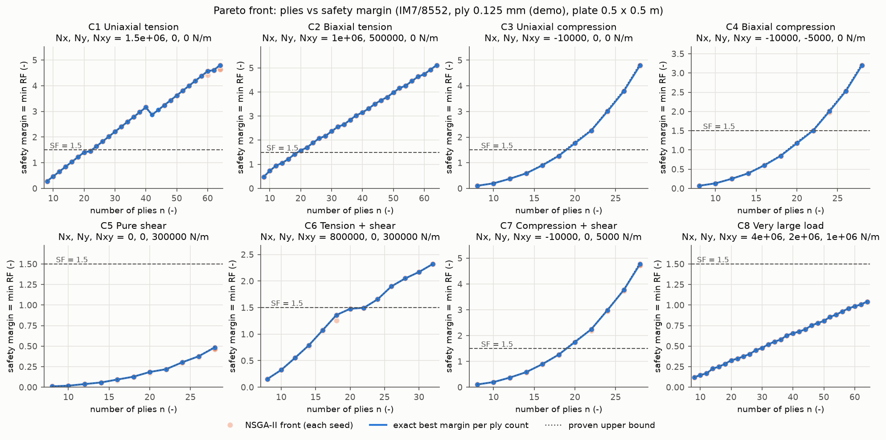
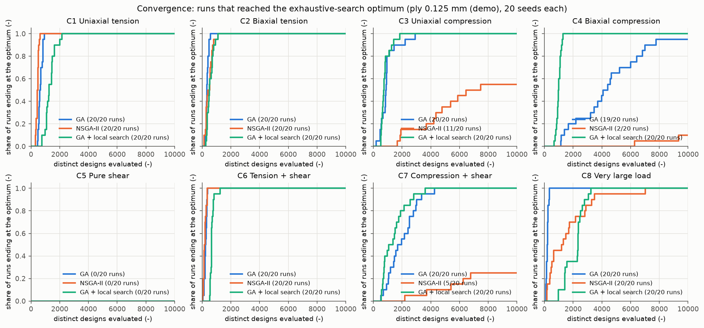
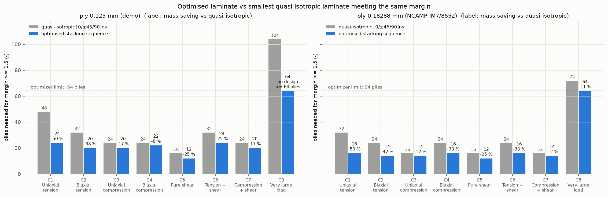
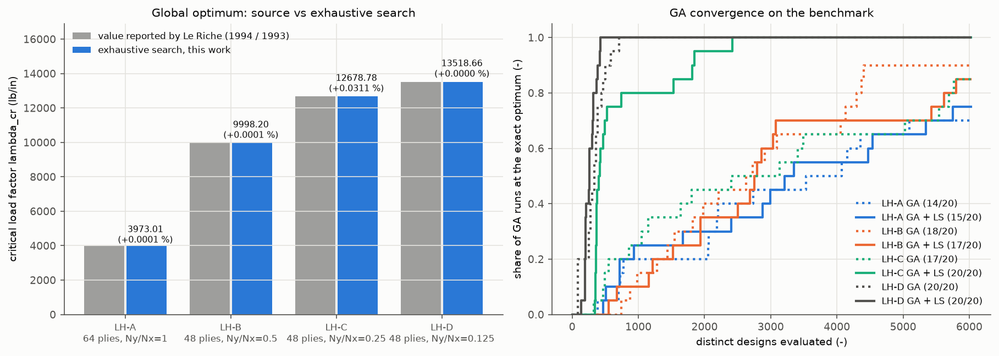

# BÁO CÁO LỚP 1 — TỐI ƯU HÓA THỨ TỰ XẾP LỚP VẬT LIỆU COMPOSITE

*Module `python/optimization` của dự án CompositeAgent — Lớp 1 (nền tảng, không dùng LLM). Ngày 28/10/2026.*

> **Đọc nhanh:** xem mục 0 (tóm tắt) và mục 9 (trang tóm tắt tiếng Anh cho GS. Nishikawa).
> Các bảng kết quả được chép nguyên văn từ `results/tables.md` (do `make_tables.py` sinh tự động từ các tệp CSV/JSON
> trong `deliverables/optimization/results/`); các con số trong lời bình được chép từ chính các bảng/tệp đó.

## 0. Tóm tắt kết quả

| Kiểm chứng | Kết quả |
|---|---|
| Python CLT ↔ MATLAB `clt_engine.m`, 60 tấm ngẫu nhiên (52 không đối xứng, 22 có mô-men, 11 vật liệu) | **60/60 đạt**; sai số tương đối lớn nhất ABD 2.1·10⁻¹⁵, ứng suất 2.5·10⁻¹⁵, chỉ số Max Stress 2.5·10⁻¹⁵ (yêu cầu ≤ 10⁻⁹) |
| GA, GA + tìm kiếm cục bộ, NSGA-II ↔ vét cạn: 8 ca tải × 2 độ dày lớp = 16 bài vét cạn được, 20 seed mỗi thuật toán, ngân sách 10 000 | **20/20 đáp án cuối đúng tối ưu toàn cục ở cả 16 bài, cho cả 3 thuật toán** (960 lần chạy) |
| Le Riche & Haftka (1993; thông số từ luận án Le Riche 1994), chế độ số lớp cố định | Vét cạn toàn bộ không gian (531 441 và 43 046 721 phương án): **trùng giá trị tối ưu công bố** 3973.01, 9998.19, 13518.66 (chênh ≤ 10⁻⁶ do làm tròn); ca Ny/Nx = 0.25 tìm được 12678.78, **cao hơn 0.031 %** thiết kế GA in trong luận án; 12 thiết kế in trong luận án được tính lại khớp ≤ 1.5·10⁻⁶ (một giá trị độ bền không quyết định lệch 0.03 %) |
| Le Riche & Haftka (1995), bài ít lớp nhất | n* = 48 lớp ở cả 3 ca như nguồn; λ tốt nhất ở 44/48 lớp = 0.879/1.040 trùng nguồn; thiết kế tối ưu ca 2 và ca 3 trùng nguyên văn Bảng 2 của nguồn |
| pytest (CLT, từng tiêu chuẩn, mất ổn định, từng luật, repair, từng thuật toán, vật liệu, MATLAB) | **78/78 đạt** (chạy lại ngày 28/10 sau khi khởi động lại máy, gồm 2 test MATLAB; trong lúc WMI treo: 76 đạt, 1 tệp test MATLAB bỏ qua, mục 4.7) |
| Kiểm tra lại các phương án tối ưu cuối bằng MATLAB | **83/83 đạt** (sau khi khởi động lại máy, mục 4.7): sai số tương đối lớn nhất ABD 1.7·10⁻¹⁵, ứng suất 3.1·10⁻¹⁵; biên an toàn MATLAB trùng Python |

**Giảm khối lượng so với tấm tựa đẳng hướng `[0/45/−45/90]ns` nhỏ nhất đạt cùng biên an toàn** (mục 4.4):
lớp 0.125 mm: kéo một phương **−50 %** (24 so với 48 lớp), kéo hai phương −37.5 %, cắt thuần −25 %, kéo + cắt −25 %,
nén một phương −16.7 %, nén + cắt −16.7 %, nén hai phương −8.3 %; tải rất lớn: **không khả thi trong 64 lớp**
(biên tốt nhất 1.043 < 1.5; tựa đẳng hướng cần 104 lớp). Lớp 0.18288 mm (NCAMP): −11 % đến −50 %.

**Cảnh báo quan trọng nhất** (mục 4.5): đúng theo đặc tả, công thức mất ổn định đóng không chứa Nxy. Kiểm tra bổ sung
bằng Ritz cho thấy phương án cắt thuần tối ưu 12 lớp **chỉ chịu được 2.3 % tải trước khi mất ổn định do cắt**;
khi xét cả cắt, cần 46 lớp (cận dưới chứng minh được: ≥ 42).


---

## 1. Bài toán

### 1.1 Composite nhiều lớp là gì, vì sao thứ tự xếp lớp quan trọng
Một **tấm composite nhiều lớp (laminate)** được ghép từ nhiều **lớp (ply)** mỏng; mỗi lớp là sợi carbon song song
trong nhựa epoxy, rất cứng và bền theo phương sợi (phương 1), yếu theo phương ngang (phương 2). Người thiết kế chọn
**góc sợi** của từng lớp (ở đây chỉ 0°, +45°, −45°, 90° như thông lệ ngành hàng không) và **thứ tự xếp lớp**
(stacking sequence), ví dụ `[0/45/−45/90]s` (chữ `s` = đối xứng qua mặt giữa: nửa còn lại là ảnh gương).

* **Số lớp** quyết định khối lượng (cùng vật liệu, cùng độ dày lớp → khối lượng tỉ lệ số lớp).
* **Số lượng lớp mỗi góc** quyết định độ cứng màng **A** (kéo – nén – cắt trong mặt phẳng) → quyết định độ bền.
* **Thứ tự** quyết định độ cứng uốn **D** (lớp càng xa mặt giữa càng góp nhiều) → quyết định **mất ổn định
  (buckling)** khi tấm chịu nén hoặc cắt.

### 1.2 Mục tiêu của Lớp 1
Tìm thứ tự xếp lớp **có ít lớp nhất** (nhẹ nhất) sao cho **biên an toàn ≥ hệ số an toàn** (mặc định 1.5) và
thỏa mọi **luật thiết kế**; nếu nhiều phương án cùng số lớp thì chọn phương án có biên an toàn lớn nhất. Ngoài ra
xây dựng **đường Pareto** (đánh đổi giữa số lớp và biên an toàn) và tái tạo bài kiểm tra kinh điển của
Le Riche & Haftka.

---

## 2. Giả định và quy ước

| Hạng mục | Lựa chọn trong Lớp 1 |
|---|---|
| Tải | Lực màng trong mặt phẳng Nx, Ny, Nxy (N/m); **kéo dương, nén âm**. **Không xét mô-men** (Mx = My = Mxy = 0; hàm `optimize` từ chối nếu có mô-men). |
| Nhiệt, ẩm | Bỏ qua ứng suất nhiệt và độ ẩm. |
| Tiêu chí phá hủy | **Lớp gãy đầu tiên** (first-ply failure): tấm coi như hỏng khi lớp đầu tiên đạt tiêu chuẩn bền. |
| Đơn vị | SI trong mọi tính toán (Pa, m, N/m). Riêng bài Le Riche & Haftka đổi từ psi, in, lb/in bằng hệ số chính xác. |
| Độ dày lớp | Tham số; mặc định **0.125 mm** (nhất quán với demo). Bộ thứ hai: **0.18288 mm = 0.0072 in**, độ dày lớp danh định của Hexcel 8552/IM7 (190 g/m²) theo NCAMP NCP-RP-2009-028 Rev B — giá trị lấy từ cột `Vf_note` của dòng IM7/8552 trong `composite_lamina_dataset_v4.csv` (“FAW 190 gsm / (rho_f 1.78 g/cc x tply 0.0072 in)”). |
| Tấm | Chữ nhật a × b, **tựa đơn bốn cạnh**; mặc định a = b = 0.5 m. |
| Vật liệu | Mặc định **IM7/8552**, số đo thật NCAMP (E1 = 162.1 GPa, E2 = 8.96 GPa, G12 = 4.69 GPa, ν12 = 0.316, Xt = 2212, Xc = 1731, Yt = 64.1, Yc = 286, S = 91.1 MPa), lấy qua cơ chế sẵn có `materials.py`. |
| Thước đo chung | **Hệ số dự trữ RF** (reserve factor) = số lần có thể nhân **toàn bộ** tải lên trước khi đạt tới hạn. **Biên an toàn** của phương án = min RF qua mọi lớp và mọi tiêu chuẩn. Ràng buộc: biên an toàn ≥ hệ số an toàn (mặc định 1.5, đổi được). |
| Tsai-Wu | F12 = F12\*·√(F11·F22) với **F12\* = −0.5** (giá trị khuyến nghị thường được trích từ Tsai & Hahn 1980); tham số đổi được. |
| Mất ổn định | Chỉ xét khi có nén (Nx < 0 hoặc Ny < 0); công thức đóng cho tấm **trực hướng đặc biệt**, **bỏ qua D16, D26**; tỉ số \|D16\|/D11, \|D26\|/D22 được in cho mọi phương án tối ưu. **Nxy không có trong công thức đóng** (không tự chế công thức mất ổn định do cắt). Phần bổ sung dùng phương pháp Ritz có nguồn (mục 3.3). |
| Góc lớp | {0, +45, −45, 90}. Hai cách mã hóa: theo **từng lớp** (mặc định, mịn nhất: số lớp bước 2) và theo **cặp lớp** 0₂ / ±45 / 90₂ như Le Riche & Haftka (số lớp bước 4). |
| Luật thiết kế (bật/tắt từng luật) | **Đối xứng**; **cân bằng** (#+45 = #−45); **mỗi họ hướng 0, ±45, 90 ≥ 10 % số lớp** (±45 tính chung một họ); **không quá 4 lớp cùng góc liền nhau**, tính trên cả tấm (kể cả hai lớp kề mặt giữa khi đối xứng). Số lớp 8–64. |

---

## 3. Phương pháp

### 3.1 Bộ tính CLT bằng Python (`clt.py`, `evaluate.py`)
**Lý thuyết tấm nhiều lớp cổ điển (CLT)**: từ E1, E2, G12, ν12 tính ma trận độ cứng lớp **Q**, xoay theo góc lớp
thành **Q̄**, cộng theo chiều dày được ma trận **ABD** (A: màng, B: ghép màng–uốn, D: uốn). Giải
[N; M] = ABD·[ε⁰; κ] được biến dạng mặt giữa ε⁰ và độ cong κ, rồi biến dạng/ứng suất từng lớp theo trục vật liệu.
**Cùng quy ước với `matlab/clt_engine.m`**: lớp 1 ở đáy (z = −h/2), cùng công thức Q̄ (m⁴, m²n²…), biến dạng kỹ
thuật, ứng suất lấy ở **giữa chiều dày lớp**, cùng chỉ số Max Stress. Hàm `cosd/sind` tái tạo cách rút gọn góc của
MATLAB nên 90° cho đúng 0.

**Vector hóa**: với tấm đối xứng chỉ chịu lực màng, B = 0 và biến dạng đều theo chiều dày (ε⁰ = A⁻¹N); A chỉ phụ
thuộc **số lớp mỗi góc**, nên ứng suất mỗi lớp chỉ phụ thuộc góc của nó; D = Σ Q̄(góc)·trọng số vị trí. Nhờ vậy
đánh giá được hàng triệu phương án/giây theo lô. Đường tính tổng quát (A, B, D, độ cong) dùng cho tấm không đối xứng
và để đối chiếu với MATLAB; hai đường khớp nhau tới 3·10⁻¹⁵ (test `test_fast_symmetric_path_equals_general_path`).

### 3.2 Tiêu chuẩn bền và hệ số dự trữ (`failure.py`)
* **Max Stress**: chỉ số FI = max(σ1/Xt hoặc −σ1/Xc, σ2/Yt hoặc −σ2/Yc, |τ12|/S) — đúng như MATLAB.
  Ứng suất tỉ lệ tuyến tính với tải nên **RF = 1/FI**.
* **Tsai-Wu**: F1σ1 + F2σ2 + F11σ1² + F22σ2² + F66τ12² + 2F12σ1σ2 = 1. Nhân tải với RF thì ứng suất nhân RF:
  a·RF² + b·RF − 1 = 0 (a: phần bậc hai, b: phần bậc nhất). Với |F12\*| < 1 phần bậc hai xác định dương nên có
  đúng một nghiệm dương; dùng công thức nghiệm ổn định số (không trừ hai số gần bằng nhau).
* **Max Strain** (chỉ cho bài Le Riche & Haftka): RF = min(ε1u/|ε1|, ε2u/|ε2|, γ12u/|γ12|).
* **Thiếu giới hạn bền**: nếu vật liệu thiếu giá trị nào (ô trống trong CSV, hoặc người dùng không cho), giá trị đó
  được thay bằng **dự đoán ML theo nhóm** của cơ chế sẵn có và **in cảnh báo** ghi rõ tên đại lượng
  (`material.py`, test `test_missing_strength_filled_by_ml_with_warning`).

### 3.3 Mất ổn định (`buckling.py`)
**Công thức đóng** (tấm trực hướng đặc biệt tựa đơn, nén hai phương; Whitney 1987; đúng phương trình (3.1) của
Le Riche 1994):

λ(m, n) = π²·[D11(m/a)⁴ + 2(D12 + 2D66)(m/a)²(n/b)² + D22(n/b)⁴] / [(m/a)²·(−Nx) + (n/b)²·(−Ny)],

chỉ các mode có mẫu dương mới mất ổn định được; **λ_cr = min theo (m, n)** = hệ số tải tới hạn = RF_buckling.
**Dò mode có chứng minh đủ**: đặt μ = (m/a)², ν = (n/b)²; vì D12 + 2D66 ≥ 0 nên tử ≥ min(D11, D22)·(μ+ν)²/2 và mẫu
≤ Nmax·(μ+ν), do đó λ(m,n) ≥ π²·min(D11,D22)·(μ+ν)/(2Nmax). Sau khi có ước lượng λ0 từ các mode nhỏ, mọi mode có
μ+ν > 2·Nmax·λ0/(π²·Dmin) chắc chắn kém hơn λ0, nên chỉ cần dò m ≤ a√R, n ≤ b√R. Test so với dò thô 60×60 mode trên
200 trường hợp ngẫu nhiên (kể cả kéo ngang): khớp tới 10⁻¹².

**Bổ sung có nguồn — Ritz có lực cắt Nxy**: chuỗi sin kép w = ΣΣ A_mn sin(mπx/a) sin(nπy/b) (phương pháp năng lượng
kinh điển cho mất ổn định do cắt của tấm tựa đơn: Timoshenko & Gere 1961 §9.7; Stein & Neff 1947; Whitney 1987 cho
tấm trực hướng), vẫn bỏ qua D16, D26. Kiểm chứng: (i) khi Nxy = 0 trùng công thức đóng tới 10⁻¹²; (ii) tấm vuông
đẳng hướng chịu cắt thuần hội tụ đơn điệu từ trên xuống k_s = 9.3245 (24×24 số hạng), sát giá trị 9.34 trong
Timoshenko & Gere (chênh 0.17 %, đúng chiều vì nghiệm Ritz là cận trên và giá trị sách tính với ít số hạng hơn);
(iii) a/b = 2 cho 6.546. Trong tối ưu dùng 10×10 số hạng (sai lệch ≤ 1.2·10⁻⁵ so với 20×20), kiểm tra cuối dùng
20×20. **Ritz chỉ là phần bổ sung**: kết quả chính theo đúng đặc tả (công thức đóng, Nxy không gây mất ổn định).

### 3.4 Biến thiết kế, luật thiết kế và cơ chế sửa (`rules.py`)
Một phương án là một **chuỗi ký hiệu** = nửa tấm từ mặt ngoài vào mặt giữa (khi đối xứng). Ký hiệu “rỗng” cho phép
số lớp thay đổi; chuỗi được **chuẩn hóa** (dồn về phía mặt giữa) nên mỗi tấm có đúng một chuỗi. `check_rules()` là
phép kiểm tra gốc trên tấm đầy đủ. **Cơ chế sửa (repair)** biến chuỗi bất kỳ thành chuỗi hợp lệ: chỉnh số lớp →
cân bằng ±45 → tối thiểu 10 % mỗi họ (lấy từ họ dư nhiều nhất) → bảo đảm số lượng xếp được trong giới hạn 4 lớp liền
→ đổi chỗ các lớp vi phạm; nếu không được thì dựng lại tham lam từ mặt giữa ra. Kiểm thử ngẫu nhiên: 1 500 chuỗi ×
19 tổ hợp luật/mã hóa (thêm 3 000 chuỗi × 17 tổ hợp khi phát triển), **không lần nào** trả về phương án vi phạm.

### 3.5 Vét cạn và cận chứng minh được (`exhaustive.py`)
* **Vét cạn theo “họ góc”**: với luật đối xứng + cân bằng, biên an toàn chỉ phụ thuộc số lớp mỗi góc (độ bền) và
  D11, D12, D22, D66 (mất ổn định) — các đại lượng này **như nhau cho +45 và −45**. Vì vậy chỉ cần liệt kê chuỗi họ
  {0, ±45, 90} (3^L thay vì 4^L); mỗi chuỗi có số lớp ±45 chẵn được đổi thành lớp thật bằng cách xen kẽ +45/−45 —
  luôn cân bằng và không tạo dãy cùng góc. Test so với liệt kê đầy đủ 4^L (bộ kiểm tra luật gốc) trên 3 tải: trùng
  tới 10⁻¹². Tốc độ ≈ 0.3–0.8 triệu chuỗi/giây (công thức đóng); giới hạn 10 phút/bài (tự ước lượng và dừng, ghi “unknown”).
* **Vét cạn theo số lượng** (khi không có mất ổn định): biên an toàn chỉ phụ thuộc bộ số lượng (n0, n+45, n−45,
  n90). Liệt kê mọi bộ số lượng + **quy hoạch động chính xác** kiểm tra có xếp được trong giới hạn 4 lớp liền →
  **tối ưu chính xác cho mọi số lớp tới 64** trong < 1 s.
* **Cận dưới chứng minh được của số lớp**: với mỗi bộ số lượng, độ bền tính chính xác, còn mất ổn định bị chặn trên
  bằng D “lạc quan” (mỗi thành phần D11, D22, D12+2D66 được cực đại riêng bằng cách đặt lớp có giá trị lớn nhất ra
  ngoài — bất đẳng thức sắp xếp lại); λ tăng theo các thành phần này nên λ(D) ≤ λ(D lạc quan). Nếu mọi bộ số lượng
  của một số lớp có cận < hệ số an toàn thì số lớp đó **chắc chắn không khả thi**. Cận này được nâng thêm qua các
  số lớp mà vét cạn đã chứng minh không khả thi (“cận dưới hiệu lực”).

### 3.6 Thuật toán di truyền và NSGA-II (`ga.py`, `nsga2.py`)
* **GA đơn mục tiêu**: quần thể 30, chọn lọc giải đấu nhị phân theo **thứ tự từ điển** (khả thi trước; khả thi thì
  ít lớp hơn rồi biên lớn hơn; không khả thi thì vi phạm nhỏ hơn — quy tắc Deb 2000), giữ 2 phương án tốt nhất
  (elitism), lai ghép hai điểm (xác suất 1) trên chuỗi canh theo mặt giữa, đột biến từng lớp (1/L), thêm/bớt lớp
  (0.10/0.10), **hoán vị hai lớp** (0.7, toán tử “stack swap” của Le Riche & Haftka), sửa sau mỗi phép biến đổi.
* **GA + tìm kiếm cục bộ (memetic)**: mỗi khi phương án tốt nhất được cải thiện, leo đồi dốc nhất trên mọi hoán vị
  hai lớp khác góc, mọi đổi góc một lớp và (bài ít lớp nhất) mọi bỏ một lớp; tại cực trị cục bộ khả thi còn thử
  **bớt lớp**: bỏ từng lớp, chọn 3 phương án mỏng hơn có biên lớn nhất, leo đồi tối đa biên ở số lớp mới, nhận nếu đạt
  lại hệ số an toàn. Mọi đánh giá tính trong cùng ngân sách. **Biến thể này được thêm sau khi GA cơ bản trượt tối ưu
  ở các bài “đánh lừa GA” của Le Riche & Haftka 1995** (mục 4.6; bước bớt lớp thêm sau khi bản đầu vẫn trượt ca 2);
  cả hai biến thể được báo cáo trên mọi bài, kết quả trong báo cáo là của phiên bản cuối.
* **NSGA-II** (pymoo 0.6.2, Deb et al. 2002): hai mục tiêu (số lớp ↓, −biên an toàn ↓); dùng **cùng** khởi tạo, lai
  ghép, đột biến và **repair** như GA (mọi phương án luôn thỏa luật), loại trùng lặp trên chuỗi chuẩn hóa; quần thể
  40. Đáp án “ít lớp nhất” lấy từ quần thể cuối: phương án khả thi ít lớp nhất, hòa thì biên lớn nhất.
* **Ngân sách** = số **phương án khác nhau** được phân tích (phương án lặp lại lấy từ bộ nhớ đệm), 10 000 cho mỗi
  lần chạy; dừng sớm nếu 100 thế hệ liền không có phương án mới. **20 seed cố định** (0–19) cho mỗi bài × mỗi thuật
  toán (10 seed cho phần bổ sung Ritz). **Thành công** = phương án cuối có **đúng số lớp tối ưu và biên an toàn bằng
  tối ưu toàn cục** (sai số tương đối 10⁻⁹) trong ngân sách; ghi số lần đánh giá lúc lần đầu đạt và thời gian chạy.
* Tham số GA/NSGA-II chọn trước, **không** tinh chỉnh trên 8 ca tải kiểm tra.

### 3.7 Kiểm chứng
1. **Python ↔ MATLAB** trên ≥ 50 tấm ngẫu nhiên (`verify_matlab.py`): ABD, ứng suất từng lớp, chỉ số Max Stress;
   sai số tương đối ≤ 10⁻⁹ (định nghĩa sai số ở đầu `matlab_check.py`; B chuẩn hóa theo A·h vì B = 0 với tấm đối xứng).
2. **GA, GA+LS, NSGA-II ↔ vét cạn** trên 8 ca tải × 2 độ dày lớp.
3. **Le Riche & Haftka** (chế độ riêng, tối đa tải phá hủy với số lớp cố định).
4. **Mọi phương án tối ưu cuối** được tính lại bằng `clt_engine.m` (`matlab_recheck.py`).
5. **pytest** cho bộ tính CLT, từng tiêu chuẩn, mất ổn định, từng luật, repair, từng thuật toán, vật liệu, MATLAB.

---

## 4. Kết quả

Tấm IM7/8552 0.5 m × 0.5 m tựa đơn, hệ số an toàn 1.5, luật mặc định (đối xứng, cân bằng, 10 %, ≤ 4 lớp liền),
8–64 lớp, mã hóa từng lớp. Tám ca tải được chọn **trước** khi chạy GA, từ ước lượng thô sao cho mỗi ca đều không tầm
thường (`experiments/cases.py`): kéo/cắt cỡ MN/m (độ bền quyết định), nén cỡ chục kN/m (tấm 0.5 m không gân mất ổn định
ở tải nhỏ hơn rất nhiều so với tải phá hủy bền), và một tải rất lớn.

### 4.1 Python ↔ MATLAB
| laminates | pass | max e_ABD | max e_stress | max e_FI | non-symmetric | with moments |
|---|---|---|---|---|---|---|
| 60 | 60 | 2.1e-15 | 2.5e-15 | 2.5e-15 | 52 | 22 |

Định nghĩa sai số: đầu tệp `matlab_check.py`. Chi tiết từng tấm: `results/matlab_verification.csv`.

### 4.2 Phương án tối ưu cho 8 ca tải
Cột: *status* `optimal` = đã chứng minh tối ưu bằng vét cạn; `infeasible` = chứng minh không có phương án khả thi
≤ 64 lớp (phương án tốt nhất vẫn được in); *proven lower bound* = cận dưới chứng minh được (mục 3.5);
*design* = nửa tấm từ mặt ngoài vào mặt giữa; *governing* = tiêu chuẩn quyết định (lớp tới hạn đánh số từ đáy như MATLAB);
*RF MS / TW / buck* = RF Max Stress / Tsai-Wu / mất ổn định (inf = không có nén nên không xét); *QI n* = số lớp
tựa đẳng hướng nhỏ nhất đạt cùng biên; *mass saving* = (QI n − n*)/QI n.

**Lớp 0.125 mm**

| case | Nx, Ny, Nxy (N/m) | status | n* | proven lower bound | design (half, outer->mid) | margin | governing | RF MS / TW / buck | |D16|/D11, |D26|/D22 | QI n | mass saving |
|---|---|---|---|---|---|---|---|---|---|---|---|
| C1 Kéo một phương | 1.5e+06, 0, 0 | optimal | 24 | 24 | [90/0/-45/0/45/0_4/90/0_2]s | 1.6401 | tsai_wu (ply 1, 90 deg) | 1.778 / 1.64 / inf | 0.023, 0.040 | 48 | 50.0 % |
| C2 Kéo hai phương | 1e+06, 500000, 0 | optimal | 20 | 20 | [90/-45/0/45/0_3/90/0_2]s | 1.5733 | max_stress (ply 3, 0 deg) | 1.573 / 1.746 / inf | 0.044, 0.051 | 32 | 37.5 % |
| C3 Nén một phương | -10000, 0, 0 | optimal | 20 | 18 | [45/-45/45/-45/45/-45/45/-45/0/90]s | 1.7623 | buckling | 101.8 / 79.45 / 1.762 | 0.111, 0.113 | 24 | 16.7 % |
| C4 Nén hai phương | -10000, -5000, 0 | optimal | 22 | 20 | [45/-45/45/-45/45/-45/0_3/90_2]s | 1.5060 | buckling | 230.8 / 408.4 / 1.506 | 0.071, 0.090 | 24 | 8.3 % |
| C5 Cắt thuần | 0, 0, 300000 | optimal | 12 | 12 | [90/-45/45/0/-45/45]s | 1.7352 | tsai_wu (ply 11, -45 deg) | 2.844 / 1.735 / inf | 0.127, 0.057 | 16 | 25.0 % |
| C6 Kéo + cắt | 800000, 0, 300000 | optimal | 24 | 24 | [90/-45/45/0/90/-45/45/0/-45/0/45/0]s | 1.6565 | tsai_wu (ply 1, 90 deg) | 2.194 / 1.657 / inf | 0.050, 0.035 | 32 | 25.0 % |
| C7 Nén + cắt | -10000, 0, 5000 | optimal | 20 | 18 | [45/-45/45/-45/45/-45/45/-45/0/90]s | 1.7623 | buckling | 101.8 / 76.76 / 1.762 | 0.111, 0.113 | 24 | 16.7 % |
| C8 Tải rất lớn | 4e+06, 2e+06, 1e+06 | infeasible | 64 | none <= 64 | [90/-45/45/0/90/-45/45/0/90/-45/45/0/90/-45/45/0/-45/45/0/-45/45/0/-45/45/0/-45/45/0/-45/45/-45/45]s | 1.0427 | max_stress (ply 1, 90 deg) | 1.043 / 1.066 / inf | 0.015, 0.015 | 104 | - |

**Lớp 0.18288 mm (độ dày danh định NCAMP của IM7/8552)**

| case | Nx, Ny, Nxy (N/m) | status | n* | proven lower bound | design (half, outer->mid) | margin | governing | RF MS / TW / buck | |D16|/D11, |D26|/D22 | QI n | mass saving |
|---|---|---|---|---|---|---|---|---|---|---|---|
| C1 Kéo một phương | 1.5e+06, 0, 0 | optimal | 16 | 16 | [90/0/-45/0_2/45/0_2]s | 1.5117 | tsai_wu (ply 1, 90 deg) | 1.718 / 1.512 / inf | 0.062, 0.079 | 32 | 50.0 % |
| C2 Kéo hai phương | 1e+06, 500000, 0 | optimal | 14 | 14 | [90/0/-45/0/45/0_2]s | 1.5463 | max_stress (ply 9, 0 deg) | 1.546 / 1.724 / inf | 0.059, 0.063 | 24 | 41.7 % |
| C3 Nén một phương | -10000, 0, 0 | optimal | 14 | 12 | [45/-45/45/-45/0_2/90]s | 1.8354 | buckling | 179 / 157.7 / 1.835 | 0.117, 0.145 | 16 | 12.5 % |
| C4 Nén hai phương | -10000, -5000, 0 | optimal | 16 | 14 | [45/-45/45/-45/45/-45/0/90]s | 1.8776 | buckling | 178.4 / 238.3 / 1.878 | 0.134, 0.139 | 24 | 33.3 % |
| C5 Cắt thuần | 0, 0, 300000 | optimal | 12 | 12 | [90/-45/45/0/-45/45]s | 2.5387 | tsai_wu (ply 2, -45 deg) | 4.161 / 2.539 / inf | 0.127, 0.057 | 16 | 25.0 % |
| C6 Kéo + cắt | 800000, 0, 300000 | optimal | 16 | 16 | [90/-45/45/0/-45/0/45/0]s | 1.6979 | tsai_wu (ply 16, 90 deg) | 2.341 / 1.698 / inf | 0.092, 0.062 | 24 | 33.3 % |
| C7 Nén + cắt | -10000, 0, 5000 | optimal | 14 | 12 | [45/-45/45/-45/0_2/90]s | 1.8354 | buckling | 179 / 131.3 / 1.835 | 0.117, 0.145 | 16 | 12.5 % |
| C8 Tải rất lớn | 4e+06, 2e+06, 1e+06 | optimal | 64 | 64 | [90/-45/45/0/90/-45/45/0/90/-45/45/0/90/-45/45/0/-45/45/0/-45/45/0/-45/45/0/-45/45/0/-45/45/-45/45]s | 1.5255 | max_stress (ply 64, 90 deg) | 1.526 / 1.56 / inf | 0.015, 0.015 | 72 | 11.1 % |

Nhận xét:
* Ca kéo: tối ưu dồn lớp 0° theo phương tải, giữ đúng tối thiểu 10 % mỗi họ; tiêu chuẩn quyết định là Tsai-Wu
  hoặc Max Stress ở lớp 90°/0°. Ca nén: mất ổn định quyết định (mode m = n = 1), lớp ±45 được đặt ra ngoài cùng
  (tăng D12 + 2D66), lớp 0/90 vào trong — đúng xu hướng kinh điển.
* Tỉ số |D16|/D11, |D26|/D22 của các phương án tối ưu ≤ 0.134 và ≤ 0.145 (lớn nhất ở C3/C4, nơi ±45 nằm ngoài);
  công thức đóng bỏ qua các số hạng này (hạn chế 2, mục 6).
* Ca C7 (nén + cắt) cho cùng phương án với C3 vì trong mô hình đặc tả Nxy chỉ ảnh hưởng độ bền (RF Tsai-Wu 76.8 thay
  vì 79.5), không ảnh hưởng mất ổn định — xem mục 4.5.
* So sánh hai độ dày lớp (khối lượng tỉ lệ tổng chiều dày): C1 3.000 mm (24 × 0.125) so với 2.926 mm (16 × 0.18288);
  C2 2.50 / 2.56; C3 2.50 / 2.56; C4 2.75 / 2.93; C5 1.50 / 2.19; C6 3.00 / 2.93; C7 2.50 / 2.56 mm. Lớp dày hơn cho bước
  điều chỉnh thô hơn (mỗi bước 0.366 mm thay vì 0.25 mm) nên có ca nặng hơn (C5: với lớp 0.18288 mm, 10 lớp chỉ đạt
  biên 1.405 vì luật cân bằng + 10 % chỉ để lại 4 lớp ±45, nên phải lên 12 lớp với biên dư 2.539), có ca nhẹ hơn
  (C1, C6). Ca C8 khả thi đúng ở 64 lớp với lớp 0.18288 mm (11.7 mm) nhưng
  không khả thi với lớp 0.125 mm (tối đa 8 mm).



*Hình 1. Đường biên an toàn tốt nhất theo số lớp (vét cạn, xanh; tập không bị trội của nó là đường Pareto chính xác),
mặt Pareto NSGA-II của từng seed (cam) và cận trên chứng minh được (chấm). Với ca có mất ổn định, vét cạn được tính
tới 32 lớp. Hình lớp 0.18288 mm: `figures/pareto_t0183.png`.*

### 4.3 GA, GA + tìm kiếm cục bộ và NSGA-II so với vét cạn
*Success* = **đáp án cuối** có đúng số lớp tối ưu và biên an toàn bằng tối ưu toàn cục (sai số 10⁻⁹) trong ngân sách
10 000 phương án; *evals to hit* = số phương án đã phân tích khi lần đầu đạt tối ưu (trung bình / lớn nhất trên các
lần thành công); *NSGA-II exact front points* = tỉ lệ điểm của đường Pareto chính xác (trong phạm vi đã vét cạn) mà
mặt NSGA-II cuối chứa đúng, trung bình 20 seed.

**Lớp 0.125 mm**

| case | exact search time | GA success | GA evals to hit (mean / max) | GA+LS success | GA+LS evals to hit (mean / max) | NSGA-II success | NSGA-II evals to hit (mean / max) | time per run GA / GA+LS / NSGA-II | NSGA-II exact front points |
|---|---|---|---|---|---|---|---|---|---|
| C1 | 0.2 s | 20/20 | 659 / 940 | 20/20 | 1321 / 2162 | 20/20 | 453 / 634 | 3.0 / 2.9 / 4.0 s | 97 % of 27 |
| C2 | 0.2 s | 20/20 | 348 / 582 | 20/20 | 554 / 1110 | 20/20 | 469 / 1101 | 3.2 / 3.1 / 3.2 s | 100 % of 29 |
| C3 | 177.6 s | 20/20 | 607 / 1040 | 20/20 | 542 / 844 | 20/20 | 1534 / 2959 | 3.4 / 3.4 / 3.3 s | 100 % of 13 |
| C4 | 161.5 s | 20/20 | 1690 / 4358 | 20/20 | 761 / 1076 | 20/20 | 2178 / 4328 | 2.8 / 2.7 / 3.3 s | 100 % of 13 |
| C5 | 0.2 s | 20/20 | 182 / 343 | 20/20 | 153 / 278 | 20/20 | 162 / 320 | 107.8 / 107.5 / 3.2 s | 98 % of 26 |
| C6 | 0.2 s | 20/20 | 225 / 425 | 20/20 | 660 / 1255 | 20/20 | 194 / 437 | 2.6 / 2.6 / 3.1 s | 100 % of 29 |
| C7 | 158.7 s | 20/20 | 607 / 1040 | 20/20 | 542 / 844 | 20/20 | 1534 / 2959 | 3.4 / 3.3 / 3.2 s | 100 % of 13 |
| C8 | 0.2 s | 20/20 | 201 / 335 | 20/20 | 2112 / 3225 | 20/20 | 1632 / 7034 | 3.0 / 2.7 / 3.1 s | 100 % of 29 |

**Lớp 0.18288 mm**

| case | exact search time | GA success | GA evals to hit (mean / max) | GA+LS success | GA+LS evals to hit (mean / max) | NSGA-II success | NSGA-II evals to hit (mean / max) | time per run GA / GA+LS / NSGA-II | NSGA-II exact front points |
|---|---|---|---|---|---|---|---|---|---|
| C1 | 0.2 s | 20/20 | 513 / 813 | 20/20 | 565 / 1178 | 20/20 | 385 / 558 | 6.8 / 6.7 / 3.7 s | 97 % of 27 |
| C2 | 0.2 s | 20/20 | 302 / 445 | 20/20 | 310 / 579 | 20/20 | 343 / 635 | 15.9 / 16.2 / 3.2 s | 100 % of 29 |
| C3 | 223.3 s | 20/20 | 239 / 557 | 20/20 | 204 / 284 | 20/20 | 1187 / 4356 | 15.3 / 15.5 / 3.2 s | 100 % of 13 |
| C4 | 245.6 s | 20/20 | 327 / 619 | 20/20 | 300 / 420 | 20/20 | 1093 / 2568 | 6.9 / 7.0 / 3.4 s | 100 % of 13 |
| C5 | 0.5 s | 20/20 | 138 / 233 | 20/20 | 137 / 170 | 20/20 | 206 / 558 | 118.2 / 117.3 / 3.1 s | 98 % of 26 |
| C6 | 0.6 s | 20/20 | 251 / 369 | 20/20 | 304 / 624 | 20/20 | 217 / 599 | 4.2 / 4.2 / 3.0 s | 100 % of 29 |
| C7 | 195.8 s | 20/20 | 239 / 557 | 20/20 | 204 / 284 | 20/20 | 1187 / 4356 | 15.2 / 15.2 / 3.2 s | 100 % of 13 |
| C8 | 0.2 s | 20/20 | 209 / 337 | 20/20 | 4543 / 5704 | 20/20 | 1880 / 5997 | 3.1 / 2.2 / 3.1 s | 100 % of 29 |

So sánh hiệu quả:
* Cả ba thuật toán **đạt 100 %** trên 16 bài; khác nhau ở chi phí. GA + tìm kiếm cục bộ nhanh nhất ở các ca có mất ổn
  định (C4 lớp 0.125 mm: trung bình 761 phương án, tối đa 1 076, so với GA 1 690 / 4 358 và NSGA-II 2 178 / 4 328);
  với ca chỉ có độ bền GA cơ bản thường rẻ hơn (tìm kiếm cục bộ tiêu tốn đánh giá cho các lân cận).
* NSGA-II tìm đáp án ít lớp nhất chậm hơn GA ở các ca mất ổn định (C3: 1 534 so với 607) vì nó đồng thời duy trì cả
  đường Pareto từ 8 đến 64 lớp; đổi lại, một lần chạy cho cả đường Pareto, đúng 97–100 % số điểm chính xác.
* Thời gian một lần chạy 2–16 s (C5: ≈ 110 s vì với bài nhỏ GA phải sinh rất nhiều thế hệ mới gặp đủ 10 000 phương
  án khác nhau; vẫn đúng tối ưu từ ≈ 150–200 đánh giá).
* **Sự cố đã sửa**: ở lượt chạy đầu, NSGA-II tìm thấy tối ưu ở 20/20 lần nhưng **đáp án cuối** chỉ đúng ở 8–20/20
  lần tùy ca (vd. C2: 11/20) — quần thể làm mất phương án tối ưu. Nguyên nhân: khoảng cách chen chúc mặc định của
  pymoo coi các thiết kế khác nhau nhưng cùng (số lớp, biên) là các điểm riêng, nên khi cắt bớt mặt thứ nhất có thể loại
  hết mọi bản sao của một điểm Pareto. Sửa: tính khoảng cách chen chúc trên các vector mục tiêu khác nhau (mỗi điểm
  giữ một bản); có test hồi quy `test_nsga2_keeps_the_optimum_in_the_final_population`. Bảng trên là sau khi sửa.



*Hình 2. Tỉ lệ lần chạy kết thúc ở tối ưu toàn cục theo số phương án đã phân tích (mốc = lần đầu đạt). Lớp 0.18288 mm:
`figures/convergence_t0183.png`; diễn biến phương án tốt nhất (trung vị, dải 25–75 %) ca C4:
`figures/best_so_far_C4_t0125.png`.*

### 4.4 So sánh với tấm tựa đẳng hướng


*Hình 3. Số lớp cần để biên ≥ 1.5: tựa đẳng hướng `[0/45/−45/90]ns` (xám, tìm tới 128 lớp) và phương án tối ưu (xanh);
nhãn = % khối lượng giảm. Số liệu: cột `qi_n`, `mass_reduction_pct` của `results/cases_summary.csv`.*

Mức giảm lớn nhất ở tải một phương (kéo: −50 %) vì tựa đẳng hướng phân bổ 3/4 số lớp vào các hướng không chịu tải;
nhỏ nhất ở nén hai phương (−8 % với lớp 0.125 mm), nơi tựa đẳng hướng đã gần tối ưu cho mất ổn định.

### 4.5 Bổ sung: mất ổn định có lực cắt (Ritz)
Đặc tả yêu cầu không tự chế công thức mất ổn định do cắt. Phương pháp Ritz chuỗi sin kép (mục 3.3, có nguồn và đã kiểm
chứng) được dùng làm **kiểm tra bổ sung** và làm một **lượt tối ưu riêng** cho các ca có Nxy (10 seed mỗi thuật toán).

| case | ply | status | n (closed form) | n (Ritz) | proven lower bound | design | margin | governing | GA / GA+LS / NSGA-II reaching it | QI n |
|---|---|---|---|---|---|---|---|---|---|---|
| C5 | t0125 | unknown (time limit) | 12 | 46 | 42 | [-45_2/45/-45_2/45_4/-45_2/45/-45_2/45_2/0/90_2/0/90/0/90]s | 1.5992 | buckling | 4/10 / 10/10 / 9/10 | 56 |
| C6 | t0125 | optimal | 24 | 24 | 24 | [0_3/45/-45/90_2/45/-45/0/45/-45]s | 1.6565 | tsai_wu | 10/10 / 9/10 / 10/10 | 32 |
| C7 | t0125 | optimal | 20 | 20 | 20 | [45/-45/45/-45/45/-45/45/-45/0/90]s | 1.6875 | buckling | 10/10 / 10/10 / 10/10 | 24 |
| C5 | t0183 | unknown (time limit) | 12 | 32 | 30 | [45/-45_2/45/-45/45/-45/45/-45/45_2/-45/90/0_2/90]s | 1.6936 | buckling | 10/10 / 10/10 / 10/10 | 40 |
| C6 | t0183 | optimal | 16 | 16 | 16 | [0/45/-45/45/-45/90/0_2]s | 1.6979 | tsai_wu | 10/10 / 10/10 / 10/10 | 24 |
| C7 | t0183 | optimal | 14 | 14 | 14 | [45/-45/45/-45/0_2/90]s | 1.7577 | buckling | 10/10 / 10/10 / 10/10 | 16 |

Closed-form designs checked with Ritz (with Nxy):

| case | ply | closed-form design | Ritz buckling factor incl. Nxy | margin incl. shear buckling |
|---|---|---|---|---|
| C5 | t0125 | [90/-45/45/0/-45/45]s | 0.023 | 0.0230 |
| C6 | t0125 | [90/-45/45/0/90/-45/45/0/-45/0/45/0]s | 2.959 | 1.6565 |
| C7 | t0125 | [45/-45/45/-45/45/-45/45/-45/0/90]s | 1.688 | 1.6875 |
| C8 | t0125 | [90/-45/45/0/90/-45/45/0/90/-45/45/0/90/-45/45/0/-45/45/0/-45/45/0/-45/45/0/-45/45/0/-45/45/-45/45]s | inf | 1.0427 |
| C5 | t0183 | [90/-45/45/0/-45/45]s | 0.07201 | 0.0720 |
| C6 | t0183 | [90/-45/45/0/-45/0/45/0]s | 2.777 | 1.6979 |
| C7 | t0183 | [45/-45/45/-45/0_2/90]s | 1.758 | 1.7577 |
| C8 | t0183 | [90/-45/45/0/90/-45/45/0/90/-45/45/0/90/-45/45/0/-45/45/0/-45/45/0/-45/45/0/-45/45/0/-45/45/-45/45]s | inf | 1.5255 |

* **Cắt thuần (C5)**: phương án tối ưu theo đặc tả (12 lớp) có hệ số mất ổn định do cắt **0.023** — tấm 0.5 m mỏng
  1.5 mm sẽ mất ổn định ở 2.3 % tải thiết kế. Khi xét cắt, cần **46 lớp** (lớp 0.125 mm; cận dưới chứng minh ≥ 42; cả 30
  lần chạy GA/GA+LS/NSGA-II đều tới 46 lớp, 4/10, 10/10, 9/10 đạt đúng biên tốt nhất đã biết) và 32 lớp với lớp 0.18288
  mm (cận dưới ≥ 30). Không gian quá lớn để vét cạn trong 10 phút nên **chưa chứng minh được tối ưu** ở ca này.
* **Kéo + cắt (C6)**: lực kéo làm tăng độ ổn định; số lớp không đổi (24 / 16), đã chứng minh tối ưu bằng vét cạn.
* **Nén + cắt (C7)**: cùng số lớp nhưng biên giảm từ 1.762 xuống 1.688 (lớp 0.125 mm) do tương tác nén–cắt.

### 4.6 Bài kiểm tra kinh điển Le Riche & Haftka
Tái tạo **đúng bài toán gốc** như một chế độ riêng (`optimization/leriche_haftka.py`): tối đa hệ số tải phá hủy
λ_cr = min(λ_cb, λ_cs) với số lớp cố định, vật liệu graphite-epoxy E1 = 18.5 Msi, E2 = 1.89 Msi, G12 = 0.93 Msi,
ν12 = 0.3, t = 0.005 in; tấm a = 20 in, b = 5 in (b = 10 in cho bài chỉ mất ổn định); Nx = 1 lb/in và Ny/Nx cho trước;
biến dạng cho phép 0.008 / 0.029 / 0.015 với hệ số 1.5 chỉ áp cho biến dạng; m, n ≤ 5; xếp theo cặp 0₂/±45/90₂;
≤ 4 lớp liền (bài có biến dạng). **Nguồn**: Chương 3 luận án Le Riche (1994) — cùng tác giả và tên với bài AIAA 1993
(bản AIAA không truy cập được, xem mục 10) — đối chiếu với Le Riche & Haftka (1995). GA chạy 20 seed × 2 biến thể,
ngân sách 6 000 phương án (bằng giới hạn mỗi lượt tìm trong bài 1995). *Practical* = trong 0.1 % tối ưu (định nghĩa
của nguồn).

| case | problem | design space | valid designs | exhaustive lambda* | # optima | source value | difference | same with full mode scan | GA exact (practical 0.1 %) | GA+LS exact (practical) | evals to exact GA / GA+LS (mean) |
|---|---|---|---|---|---|---|---|---|---|---|---|
| LH-A | buckling only, 64 plies, a/b = 2, Ny/Nx = 1 | 43,046,721 | 43,046,721 | 3973.01 | 7 | 3973.01 | +0.00009 % | 3973.01 | 14/20 (20) | 15/20 (20) | 2502 / 2663 |
| LH-B | buckling + strain + contiguity, 48 plies, Ny/Nx = 0.5 | 531,441 | 243,569 | 9998.20 | 1 | 9998.19 | +0.00009 % | 9998.20 | 18/20 (20) | 17/20 (20) | 2529 / 2679 |
| LH-C | buckling + strain + contiguity, 48 plies, Ny/Nx = 0.25 | 531,441 | 243,569 | 12678.78 | 2 | 12674.84 | +0.03106 % | 12678.78 | 17/20 (19) | 20/20 (20) | 2519 / 717 |
| LH-D | buckling + strain + contiguity, 48 plies, Ny/Nx = 0.125 | 531,441 | 243,569 | 13518.66 | 169 | 13518.66 | +0.00000 % | 13518.66 | 20/20 (20) | 20/20 (20) | 328 / 270 |

Optimal designs found by exhaustive search:

| case | design (stacks, half) | governing | mode (m,n) |
|---|---|---|---|
| LH-A | [±45/90_8/±45/90_18/±45]s | buckling | (2, 1) |
| LH-B | [90_2/(±45)_2/90_2/±45/90_2/(±45)_6]s | buckling | (3, 1) |
| LH-C | [(±45)_2/90_2/(±45)_3/0_2/±45/0_4/±45/0_2]s | max_strain | (2, 1) |
| LH-D | [±45/0_2/(±45)_4/0_2/±45/0_4/90_2/0_2]s | max_strain | (3, 1) |

**Tính lại các thiết kế in trong nguồn** (kiểm tra mô hình): λ_b, λ_cs của chúng tôi so với số in trong luận án.

| case | design (stacks outer->mid) | lambda_b ours | lambda_b source | rel. diff | lambda_cs ours | lambda_cs source | rel. diff |
|---|---|---|---|---|---|---|---|
| LH-A | 90 90 90 90 90 ± ± 90 ± ± ± 90 ± ± ± ± | 3973.01 | 3973.01 | +9.4e-07 | 14205.19 | 14205.18 | +5.0e-07 |
| LH-A | ± 90 90 90 90 90 ± 90 90 90 90 ± 90 90 90 90 | 3973.01 | 3973.01 | +9.4e-07 | 8935.74 | 8935.74 | -4.9e-09 |
| LH-A | 90 90 ± ± 90 90 90 90 90 90 90 90 ± 90 90 90 | 3973.01 | 3973.01 | +9.4e-07 | 8935.74 | 8935.74 | -4.9e-09 |
| LH-A | 90 ± 90 90 90 ± 90 90 90 90 ± 90 90 90 90 90 | 3973.01 | 3973.01 | +9.4e-07 | 8935.74 | 8935.74 | -4.9e-09 |
| LH-A | 90 90 90 90 ± 90 ± 90 ± 90 ± ± ± ± ± ± | 3973.01 | 3973.01 | +9.4e-07 | 14205.19 | 14205.18 | +5.0e-07 |
| LH-B | 90 ± ± 90 ± 90 ± ± ± ± ± ± | 9998.20 | 9998.19 | +8.8e-07 | 10398.14 | 10394.81 | +3.2e-04 |
| LH-B | 90 ± ± 90 ± ± 90 ± 90 ± ± ± | 9997.61 | 9997.60 | +1.5e-06 | 10187.94 | 10187.93 | +6.4e-07 |
| LH-B | ± 90 90 ± 90 ± ± ± ± ± 90 ± | 9976.59 | 9976.58 | +1.1e-06 | 10187.94 | 10187.93 | +6.4e-07 |
| LH-C | 90 ± ± ± ± ± 0 ± 0 0 ± 0 | 12674.85 | nan | - | 12678.78 | nan | - |
| LH-D | 90 ± ± ± ± 0 0 ± 0 0 ± 0 | 14168.13 | 14168.12 | +8.3e-07 | 13518.66 | 13518.66 | +4.6e-08 |
| LH-D | ± ± ± 0 ± ± 0 90 0 0 ± 0 | 14134.78 | 14134.76 | +1.4e-06 | 13518.66 | 13518.66 | +4.6e-08 |
| LH-D | 90 ± ± ± 0 ± 0 ± 0 0 ± 0 | 14013.72 | 14013.71 | +9.5e-07 | 13518.66 | 13518.66 | +4.6e-08 |
| LH-D | ± ± 0 ± ± 90 0 0 ± 0 ± 0 | 13662.62 | 13662.61 | +8.9e-07 | 13518.66 | 13518.66 | +4.6e-08 |

Hàng LH-C: luận án (Hình 3.12) chỉ in λ_cr = 12674.84 của thiết kế GA này; λ_b của chúng tôi = 12674.85 là giá trị
quyết định. Hàng LH-B đầu: λ_cs lệch 0.03 % (10398.14 so với 10394.81) — giá trị không quyết định (λ_cr = λ_b khớp tới
10⁻⁶); hai thiết kế khác cùng số lượng lớp cho λ_cs = 10187.94 khớp nguồn, nên chênh lệch có thể do lỗi in hoặc chép;
chúng tôi không giải thích được chắc chắn.

**Bài ít lớp nhất của Le Riche & Haftka (1995)** (kiểm chứng phụ cho chế độ “ít lớp nhất”, tiêu chuẩn biến dạng,
λ_cr ≥ 1):

| case | Nx, Ny (lb/in) | n* (exhaustive) | lambda_cr | design | best lambda at 44 / 48 / 52 | source | GA exact | GA+LS exact |
|---|---|---|---|---|---|---|---|---|
| LC1 | 13000, 1625 | 48 | 1.0399 | [±45/0_2/(±45)_4/0_2/±45/0_4/90_2/0_2]s | 0.879 / 1.040 / 1.262 | n* = 48; 0.879 / 1.040 / 1.201 | 20/20 | 20/20 |
| LC2 | 12500, 3125 | 48 | 1.0143 | [(±45)_2/90_2/(±45)_3/0_2/±45/0_4/±45/0_2]s | 0.807 / 1.014 / 1.193 | n* = 48 | 6/20 | 20/20 |
| LC3 | 9800, 4900 | 48 | 1.0202 | [90_2/(±45)_2/90_2/±45/90_2/(±45)_6]s | 0.786 / 1.020 / 1.262 | n* = 48 | 2/20 | 3/20 |

* Số lớp tối ưu 48 ở cả 3 ca trùng nguồn; λ tốt nhất ở 44 và 48 lớp của ca 1 trùng 0.879 và 1.040 do nguồn công bố;
  ở 52 lớp vét cạn cho 1.262 > 1.201 (nguồn ghi “thiết kế tốt nhất tìm được”, không khẳng định là tối ưu).
* Thiết kế tối ưu ca 2 `[(±45)₂/90₂/(±45)₃/0₂/±45/0₄/±45/0₂]s` và ca 3 `[90₂/(±45)₂/90₂/±45/90₂/(±45)₆]s` **trùng
  nguyên văn** Bảng 2 của nguồn; ca 1 có nhiều tối ưu cùng λ (nguồn: > 13 tối ưu thực hành).
* GA cơ bản chỉ đạt 6/20 (ca 2) và 2/20 (ca 3) → đây là lý do thêm tìm kiếm cục bộ (ca 2: 20/20). **Ca 3 vẫn chỉ
  3/20** — nguồn mô tả ca này là “đánh lừa GA” (tối ưu không có lớp 0° nhưng các lớp 0° là nơi biến dạng tới hạn, nên
  bỏ dần lớp 0° làm phương án tạm thời xấu đi). Các lần trượt dừng ở 48 lớp với λ 1.0199 (kém 0.03 %) hoặc 1.0003, hoặc
  ở 52 lớp. Đây là hạn chế còn lại của GA.



*Hình 4. Trái: tối ưu toàn cục (vét cạn) so với giá trị nguồn. Phải: tỉ lệ lần chạy GA đạt đúng tối ưu theo ngân sách
(chấm: GA, liền: GA + tìm kiếm cục bộ).*

### 4.7 Kiểm tra lại bằng MATLAB các phương án tối ưu cuối
| designs | pass | max e_ABD | max e_stress | max \|RF diff\| |
|---|---|---|---|---|
| 83 | 83 | 1.7e-15 | 3.1e-15 | 5.7e-15 |

Cả 83 phương án tối ưu cuối được tính lại bằng `clt_engine.m`: với mỗi bài (16 bài mô hình chính + 6 bài Ritz), phương án
tham chiếu (vét cạn, hoặc tốt nhất trong mọi lần chạy khi vét cạn không xong) và phương án tốt nhất của từng thuật toán
khi nó khác phương án tham chiếu (62 phương án mô hình chính, 21 phương án Ritz). Kết quả: **83/83 đạt**, thời gian 77.5 s. Chi tiết từng phương án:
`results/matlab_final_designs.csv`; cột `matlab_pass`, `margin_matlab` của `results/cases_summary.csv` đã được điền.

Ghi chú quá trình: lần chạy đầu (khoảng 02:10–02:18 ngày 28/10) không thực hiện được vì dịch vụ WMI của Windows ngừng
phản hồi ngay sau một lần chạy song song 16 tiến trình bị lỗi cấp phát bộ nhớ của OpenBLAS (`tasklist`, `taskkill`,
`Get-CimInstance`, `platform.platform()` của Python và `import matlab.engine` đều treo). Sau khi khởi động lại máy,
`..\venv\Scripts\python.exe -m optimization.experiments.matlab_recheck` (trong thư mục `python`) chạy bình thường và cho
kết quả trên; `results/tables.md` được sinh lại bằng `make_tables`.

## 5. Đánh giá chung
* Bộ tính CLT Python có thể thay MATLAB trong vòng lặp tối ưu (khớp tới sai số máy, nhanh hơn nhiều bậc).
* Với bài cỡ thực tế của dự án (≤ 34 lớp khi có mất ổn định, mọi số lớp khi chỉ có độ bền), **vét cạn + cận chứng minh
  được cho đáp án tối ưu chắc chắn** trong vài phút; GA/NSGA-II cần cho bài lớn hơn, nhiều trường hợp tải, mô hình
  đắt hơn (Ritz, FEM) và cho Lớp 2/3.
* Cả ba thuật toán đều tìm đúng tối ưu ở mọi bài vét cạn được của 8 ca tải; GA + tìm kiếm cục bộ ổn định nhất trên
  các bài khó (Le Riche & Haftka), NSGA-II cho thêm cả đường Pareto trong một lần chạy.


---

## 6. Hạn chế còn lại

1. **Mất ổn định do cắt không có trong mô hình chính** (đúng đặc tả). Phần bổ sung Ritz cho thấy với tấm 0.5 m
   chịu cắt thuần, mất ổn định do cắt quyết định và cần nhiều lớp hơn hẳn (mục 4.5) — kết quả chính của các ca có
   Nxy **không được dùng để thiết kế thật** nếu chưa xét mất ổn định do cắt.
2. **Bỏ qua D16, D26** trong cả công thức đóng lẫn Ritz; tỉ số |D16|/D11, |D26|/D22 của các phương án tối ưu được in
   trong bảng (mục 4.2). Với tấm có nhiều lớp ±45 ở ngoài, tỉ số này có thể lớn và tải mất ổn định thật thấp hơn.
3. Tấm **không đối xứng** (khi tắt luật đối xứng): công thức đóng chỉ dùng D, bỏ qua ghép B (có cảnh báo).
4. **Lớp gãy đầu tiên**, không xét phá hủy lũy tiến, tách lớp, cạnh tự do, lỗ, va đập (BVID), mỏi, nhiệt–ẩm,
   mô-men uốn. Độ bền là **giá trị trung bình RTD** của NCAMP, không phải giá trị cho phép B-basis — thiết kế thật cần
   giá trị cho phép và hệ số giảm (knock-down); Lớp 2 sẽ xét sai số dự đoán ML.
5. **Vét cạn có giới hạn**: với bài có mất ổn định, vét cạn hết được tới khoảng 32–34 lớp trong 10 phút. Bài lớn
   hơn (vd. cắt thuần với Ritz) chỉ có **cận dưới chứng minh được** và kết quả GA/NSGA-II nhất quán giữa các seed,
   không có chứng minh tối ưu.
6. **Biến thể GA + tìm kiếm cục bộ được thêm sau khi thấy GA cơ bản thất bại** ở bài “đánh lừa GA” của
   Le Riche & Haftka 1995; tham số GA/NSGA-II không được tinh chỉnh kỹ; tỉ lệ thành công phụ thuộc ngân sách 10 000.
7. Góc chỉ {0, ±45, 90}; độ dày lớp cố định; tấm chữ nhật tựa đơn; một trường hợp tải mỗi lần tối ưu
   (chưa có tối ưu đồng thời nhiều trường hợp tải, chưa có nhiều vùng/blending).
8. Bài báo AIAA 1993 của Le Riche & Haftka **không truy cập được**; thông số lấy từ Chương 3 luận án Le Riche (1994)
   (cùng tác giả, cùng tên và nội dung) và đối chiếu với bài 1995 của chính hai tác giả.
9. Quy tắc 10 % được hiểu theo họ hướng (0, ±45 chung, 90), áp lên số lớp của cả tấm.
10. So sánh với tựa đẳng hướng dùng `[0/45/−45/90]ns` (số lớp bội 8); khối lượng so sánh qua số lớp (cùng vật liệu,
    cùng độ dày lớp).

## 7. Cách chạy lại

```
python\optimization\run_optimization.bat           (pytest + toàn bộ thí nghiệm, khoảng 1–1.5 giờ trên 20 nhân)
python\optimization\run_optimization.bat --quick   (pytest + bản rút gọn: 3 seed, ngân sách 3 000; đã chạy thử:
                                                   ~2.5 phút test + 10.6 phút thí nghiệm, trong đó ~5 phút chờ dò
                                                   MATLAB khi engine hỏng; ghi vào results_quick\ và figures_quick\)
```
Từng bước (trong thư mục `python`, dùng `..\venv\Scripts\python.exe`):
`-m optimization.run_tests` · `-m optimization.experiments.verify_matlab` · `-m optimization.experiments.run_cases`
· `-m optimization.experiments.matlab_recheck` · `-m optimization.experiments.leriche_haftka_exp`
· `-m optimization.experiments.make_figures` · `-m optimization.experiments.make_tables`.

Dùng trong code (Lớp 2, Lớp 3):
```python
from optimization import optimize, Rules, Plate, get_material
res = optimize({"Nx": -1e4, "Ny": -5e3, "Nxy": 0}, material="IM7/8552", method="ga", seed=1,
               rules=Rules(max_contiguous=4), plate=Plate(0.5, 0.5), safety_factor=1.5, verify_matlab=False)
print(res.summary())        # thứ tự xếp lớp, số lớp, RF từng tiêu chuẩn, tiêu chuẩn & lớp tới hạn, thời gian
res.to_dict()               # kết quả có cấu trúc (JSON được)
```
`material` có thể là đối tượng `Material` (Lớp 2 thay bằng mẫu ngẫu nhiên của tính chất vật liệu).

Ghi chú vận hành: ngày 28/10 dịch vụ WMI của Windows trên máy này từng bị treo (hết sau khi khởi động lại máy), làm `platform` của Python (và pandas,
pytest, `tasklist`, `taskkill`, `import matlab.engine`) treo. Module tối ưu tự tắt truy vấn WMI của Python
(`optimization/__init__.py`, `run_tests.py`); phần MATLAB tự dò bằng tiến trình con có giới hạn thời gian và báo rõ
nếu không chạy được, không treo.

## 8. Thuật ngữ cho người mới bắt đầu

| Thuật ngữ | Giải thích ngắn |
|---|---|
| Lớp (ply), tấm nhiều lớp (laminate) | Lớp sợi một hướng dày ~0.1–0.2 mm; tấm gồm nhiều lớp xếp chồng. |
| Thứ tự xếp lớp (stacking sequence) | Danh sách góc sợi từ mặt ngoài vào trong, vd. `[45/−45/0₂/90]s`; chỉ số dưới = số lớp liền nhau cùng góc; `s` = đối xứng. |
| CLT | Lý thuyết tấm nhiều lớp cổ điển: từ tính chất lớp và thứ tự xếp lớp tính độ cứng và ứng suất từng lớp. |
| A, B, D | Ma trận độ cứng màng (kéo/nén/cắt trong mặt phẳng), ghép màng–uốn, uốn. |
| D16, D26 | Thành phần ghép uốn–xoắn; = 0 với tấm “trực hướng đặc biệt”. |
| Max Stress, Tsai-Wu | Hai tiêu chuẩn bền của lớp: so từng ứng suất với giới hạn bền / một biểu thức bậc hai gộp các ứng suất. |
| F12\* | Hệ số tương tác chuẩn hóa trong Tsai-Wu (ở đây −0.5). |
| Mất ổn định (buckling), mode (m, n) | Tấm mỏng chịu nén bị võng ngang đột ngột; m, n = số nửa sóng theo x, y. |
| Hệ số dự trữ RF | Số lần nhân toàn bộ tải để vừa chạm tới hạn; RF ≥ 1 là chưa hỏng. |
| Biên an toàn, hệ số an toàn | Biên = min RF qua mọi lớp và tiêu chuẩn; yêu cầu biên ≥ hệ số an toàn (1.5). |
| Lớp gãy đầu tiên | Tấm coi như hỏng khi lớp đầu tiên đạt tiêu chuẩn bền. |
| Đối xứng / cân bằng / 10 % / liền nhau | Các luật thiết kế: tránh cong vênh, tránh ghép kéo–cắt, đủ lớp mỗi hướng, tránh nứt nền khi nhiều lớp cùng góc. |
| Tựa đẳng hướng (quasi-isotropic) | `[0/45/−45/90]ns`: tấm có độ cứng màng như nhau mọi hướng; dùng làm mốc so sánh. |
| Vét cạn | Thử **mọi** phương án hợp lệ → đáp án tối ưu chắc chắn (chỉ khả thi khi không gian nhỏ). |
| Cận dưới chứng minh được | Số lớp mà dưới đó đã chứng minh không có phương án khả thi. |
| GA (thuật toán di truyền) | Tìm kiếm ngẫu nhiên có định hướng: quần thể phương án, chọn lọc, lai ghép, đột biến. |
| Tìm kiếm cục bộ (memetic) | Thử mọi thay đổi nhỏ quanh phương án tốt nhất và giữ thay đổi tốt hơn. |
| NSGA-II, đường Pareto | Thuật toán tiến hóa đa mục tiêu; đường Pareto = tập phương án không thể cải thiện mục tiêu này mà không làm xấu mục tiêu kia (ở đây: ít lớp hơn ↔ biên an toàn nhỏ hơn). |
| Repair (sửa) | Biến một phương án vi phạm luật thành phương án hợp lệ gần nó. |
| Seed | Hạt giống ngẫu nhiên; cố định seed thì chạy lại cho đúng kết quả cũ. |
| Ngân sách đánh giá | Số phương án khác nhau được phép phân tích trong một lần chạy (10 000). |
| Tỉ lệ thành công | Số lần chạy tìm đúng tối ưu toàn cục / tổng số lần chạy. |
| Ritz | Phương pháp năng lượng gần đúng: biểu diễn độ võng bằng tổng các hàm sin, cho giá trị tải mất ổn định là cận trên, hội tụ khi tăng số hạng. |

## 9. One-page summary in English (for Prof. Nishikawa)

**Layer 1 – stacking sequence optimization (no LLM).** Module `python/optimization` of CompositeAgent, 28 Oct 2026.

**Problem.** Find the lightest symmetric laminate of IM7/8552 (measured NCAMP properties) with plies at 0/±45/90° that
carries in-plane loads Nx, Ny, Nxy on a simply supported 0.5 m × 0.5 m plate with a safety margin ≥ 1.5. Margin =
minimum reserve factor over all plies and criteria: Max Stress, Tsai-Wu (F12\* = −0.5), and closed-form biaxial-compression
buckling of a specially orthotropic plate (D16, D26 neglected; their ratios are reported; mode search proven complete).
Design rules (each switchable): symmetry, balance, ≥ 10 % of plies in each of 0/±45/90, ≤ 4 contiguous identical plies
(across the mid-plane too), 8–64 plies. First-ply failure, no moments, no hygrothermal stresses, SI units.

**Methods.** Vectorised numpy CLT with the same conventions as the agent's `clt_engine.m`; exact search (enumeration of
family strings, count-level enumeration with a dynamic-programming arrangement test, and a certified lower bound on the
ply count from an optimistic-D buckling bound); a single-objective GA (fewest plies, then largest margin; Deb's
feasibility rules; repair operator so that every design satisfies the rules), the same GA with local search (memetic,
incl. a ply-removal step), and NSGA-II (pymoo 0.6.2, plies vs margin, same operators and repair). 20 fixed seeds per
problem and algorithm, budget 10 000 distinct designs; success = final answer equals the exhaustive global optimum.

**Verification.**
* Python CLT vs MATLAB `clt_engine.m`: 60 random laminates (52 non-symmetric, 22 with moments, 11 materials): all pass,
  max relative error 2.5·10⁻¹⁵ (required ≤ 10⁻⁹) for ABD, ply stresses and Max-Stress index.
* 8 load cases (uniaxial/biaxial tension, uniaxial/biaxial compression with buckling, pure shear, tension+shear,
  compression+shear, very large load) × 2 ply thicknesses (0.125 mm; 0.18288 mm = NCAMP nominal): all 16 problems
  solved exactly; **GA, GA+local search and NSGA-II each reached the exact optimum in 20/20 runs on all 16 problems**
  (960 runs). NSGA-II also recovers 97–100 % of the exact Pareto points. A pymoo crowding-distance issue (Pareto points
  lost when many designs share the same objectives) was found and fixed; a regression test was added.
* Le Riche & Haftka benchmark (fixed-thickness failure-load maximization, data from Le Riche's 1994 thesis, Chapter 3,
  which reproduces the AIAA J. 1993 paper; the 1993 paper itself was not accessible): our model reproduces all 12
  printed design values to ≤ 1.5·10⁻⁶ (one non-governing strength value differs by 0.03 %); full enumeration
  (531 441 / 43 046 721 designs) confirms the published optima 3973.01, 9998.19 and 13518.66, and finds 12678.78 for
  Ny/Nx = 0.25, 0.031 % above the GA design printed in the thesis. GA+local search hits the exact optimum in 15, 17, 20,
  20 of 20 runs (100 % within 0.1 %) with a 6 000-analysis budget. For the 1995 minimum-thickness cases the optimum (48 plies)
  and the optimal designs of cases 2 and 3 coincide with the paper; the "GA-deceptive" case 3 is still solved exactly in
  only 3/20 runs (other runs stop 0.03 % below or at 52 plies).

**Main results.** Mass reduction versus the smallest quasi-isotropic [0/±45/90]ns laminate with the same margin
(0.125 mm plies): −50 % uniaxial tension (24 vs 48 plies), −37.5 % biaxial tension, −25 % pure shear and tension+shear,
−16.7 % uniaxial compression and compression+shear, −8.3 % biaxial compression; the very large load is reported as
infeasible within 64 plies (best margin 1.04). With 0.18288 mm plies: −11 % to −50 %.

**Limitations.** (1) As specified, shear does not enter the closed-form buckling check: a Rayleigh-Ritz check (double
sine series, validated against k_s = 9.34 for an isotropic square plate) shows that the 12-ply pure-shear optimum would
buckle at 2.3 % of the load; with shear buckling 46 plies are needed (proven lower bound 42). (2) D16/D26 neglected
(ratios up to 0.15 reported). (3) Mean (not B-basis) strengths, first-ply failure, single load case, fixed angle set.
(4) Exhaustive proofs only up to ~34 plies when buckling is active. (5) The "GA-deceptive" 1995 case 3 is solved
exactly in only 3/20 runs. All 83 final designs were re-checked in MATLAB `clt_engine.m` (83/83 pass, max relative
error 3.1·10⁻¹⁵) and the pytest suite passes 78/78. The original agent demo files were not modified (git diff empty).

## 10. Tài liệu tham khảo (chỉ những nguồn đã dùng)

1. R. Le Riche, *Optimization of Composite Structures by Genetic Algorithms*, PhD thesis, Virginia Polytechnic
   Institute and State University, Oct. 1994, Chương 3 (tr. 30–55). https://vtechworks.lib.vt.edu/handle/10919/38270 — đã đọc (PDF).
2. R. Le Riche, R.T. Haftka, “Optimization of laminate stacking sequence for buckling load maximization by genetic
   algorithm”, *AIAA Journal* 31(5):951–956, 1993 — chỉ xác minh được thông tin thư mục (NASA NTRS 19930051635);
   nội dung lấy qua [1].
3. R. Le Riche, R.T. Haftka, “Improved genetic algorithm for minimum thickness composite laminate design”,
   *Composites Engineering* 5(2):143–161, 1995. http://www.emse.fr/~leriche/ga95.pdf — đã đọc (PDF).
4. NCAMP, *Hexcel 8552 IM7 Unidirectional Prepreg … Statistical Analysis Report*, NCP-RP-2009-028 Rev B — qua dòng
   IM7/8552 của `composite_lamina_dataset_v4.csv` (đã đối chiếu PDF ở giai đoạn trước của dự án, tr. 37).
5. S.W. Tsai, H.T. Hahn, *Introduction to Composite Materials*, Technomic, 1980 — nguồn thường được trích cho
   F12\* = −1/2 (giá trị mặc định, đổi được).
6. J.M. Whitney, *Structural Analysis of Laminated Anisotropic Plates*, Technomic, 1987 — mất ổn định tấm trực hướng.
7. S.P. Timoshenko, J.M. Gere, *Theory of Elastic Stability*, 2nd ed., McGraw-Hill, 1961, §9.7 — mất ổn định do cắt
   của tấm tựa đơn (k_s = 9.34 cho tấm vuông).
8. M. Stein, J. Neff, *Buckling stresses of simply supported rectangular flat plates in shear*, NACA TN 1222, 1947.
9. K. Deb, A. Pratap, S. Agarwal, T. Meyarivan, “A fast and elitist multiobjective genetic algorithm: NSGA-II”,
   *IEEE Trans. Evolutionary Computation* 6(2):182–197, 2002.
10. K. Deb, “An efficient constraint handling method for genetic algorithms”, *Computer Methods in Applied Mechanics
    and Engineering* 186:311–338, 2000.
11. J. Blank, K. Deb, “pymoo: Multi-objective optimization in Python”, *IEEE Access* 8:89497–89509, 2020.
